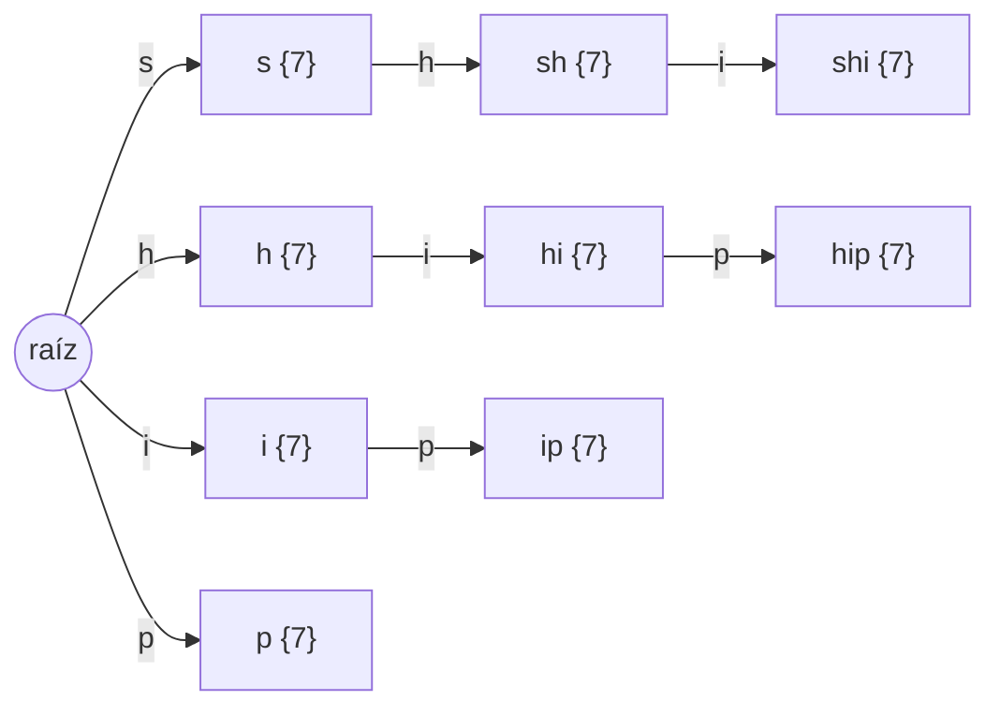

# Árbol: Trie de subcadenas de K caracteres

El índice de la aplicación es un **Trie** (árbol de prefijos) cuyos nodos guardan caracteres. A diferencia de un Trie de palabras, no se insertan palabras enteras: para cada posición de cada texto se inserta la **subcadena de hasta K caracteres** que empieza ahí. Es un *suffix trie* recortado a profundidad K. Con **K = 3** sirve para buscar palabras, frases y partes de palabras en cualquier lugar del texto.

Código: `src/03_arbol_insercion/MovieTrie(arbol).{h,cpp}`.

---

## 1. Estructura

```cpp
struct TrieNode {                                   // MovieTrie(arbol).h:20-31
    std::unordered_map<char, TrieNode*> children;   // un hijo por carácter
    std::unordered_set<size_t> movieIds;            // películas cuyo texto contiene este camino
};
static constexpr size_t KEY_SIZE = 3;               // MovieTrie(arbol).h:36
```

- Cada **arista** es un carácter (un byte del texto en UTF-8, ya normalizado). Cada **nodo** a profundidad d representa una cadena de d caracteres (d ≤ 3).
- `movieIds` de un nodo = las películas que contienen esa cadena en alguno de sus campos indexados. El id es la **posición de la película en el vector del catálogo**; por eso el árbol y el vector se guardan juntos en el Singleton `IndiceGlobal` (ver [patrones_diseno.md](patrones_diseno.md)).
- Se usa `unordered_set` para que una película no se repita en un nodo aunque la cadena aparezca muchas veces en su sinopsis.
- **Campos indexados** (`camposIndexados`, `MovieTrie(arbol).cpp:44-46`): título, sinopsis, director, reparto y género. No se indexan el año, el origen ni la página de Wikipedia.
- Cada campo se indexa **por separado**: ninguna clave mezcla el final de un campo con el comienzo del siguiente.

### Ejemplo

Indexar el título "Ship" de la película 7 (normalizado: `ship`) inserta las claves `shi`, `hip`, `ip` y `p`. El id 7 queda en cada nodo del camino:



Buscar `hi` recorre raíz → h → i y devuelve {7}; buscar `ship` recorta a `shi` y devuelve {7} como **candidato**, que después se verifica (sección 3).

---

## 2. Inserción

### Paso a paso (`MovieTrie::buildSecuencial`, `MovieTrie(arbol).cpp:106-128`, e `insertKey`, `:18-27`)

Para cada película `id` y cada uno de sus 5 campos:

1. Normalizar el campo con `DataCleaner::normalizeForSearch`: espacios y controles limpios, minúsculas ASCII y de letras latinas acentuadas (ver [preprocesamiento.md](preprocesamiento.md)).
2. Para cada posición `i` del texto normalizado, tomar `clave = texto.substr(i, 3)`. Cerca del final quedan claves más cortas.
3. Recorrer la clave desde la raíz. Si falta un hijo para el carácter, se crea. En **cada** nodo del recorrido se agrega `id` a `movieIds`.

Cada carácter normalizado genera una clave y cada clave visita como máximo 3 nodos.

### Versión paralela

Con más de un hilo y al menos 64 películas (`MIN_PELICULAS_PARALELO`, `MovieTrie(arbol).h:49`), `buildIndex` (`MovieTrie(arbol).cpp:90-102`) usa `buildParalelo` (`:161-232`):

- **Fase A:** normaliza los textos en paralelo y cuenta cuántas claves empiezan con cada byte.
- **Fase B:** reparte los primeros bytes entre los hilos con LPT.
- **Fase C:** cada hilo construye **solo los subárboles de sus bytes**, sin locks.

El árbol resultante es idéntico nodo por nodo al secuencial (lo comprueba `MovieTrie::mismoContenido` en `paralelo_tests`). Detalles y mediciones en [programacion_paralela.md](programacion_paralela.md).

Al construir de nuevo, el árbol anterior se libera (`buildIndex` reemplaza la raíz) y los ids viejos no quedan.

---

## 3. Búsqueda

### En el árbol (`MovieTrie::searchSubstring`, `MovieTrie(arbol).cpp:234-248`)

1. Normalizar la consulta con la misma función que la inserción.
2. Recortarla a sus primeros 3 caracteres (`keyFromQuery`, `:29-34`).
3. Bajar desde la raíz carácter por carácter. Si falta un hijo, no hay resultados.
4. Devolver el `movieIds` del último nodo.

**Si la consulta tiene 3 caracteres o menos**, el resultado es exacto: son justo las películas que la contienen. **Si es más larga**, el árbol devuelve las que contienen sus 3 primeros caracteres, un **superconjunto** con falsos positivos. Por ejemplo, `ship` devuelve todo lo que contiene `shi` (como "shield"), y `shipwreck` también todo lo que contiene `shi`.

### Verificación (`src/04_busqueda/`)

Las estrategias de búsqueda verifican cada candidato con `contiene` sobre los campos normalizados:

- **Texto** (`BusquedaTexto`): para varias palabras, los candidatos son la **unión** de `searchSubstring(palabra)` de cada una (`candidatosTexto`, `BusquedaComun.cpp:99-106`). Un candidato sin ninguna palabra recibe prioridad 0 y se descarta (`prioridadTexto`, `BusquedaComun.cpp:108-131`). Orden y puntajes en [algoritmos.md](algoritmos.md).
- **Tag** (`BusquedaTag`): un solo `searchSubstring` de la consulta completa y verificación de que el campo elegido la contiene (`Busqueda.cpp:162-188`).

Así, los **resultados son siempre exactos**. El árbol solo reduce cuántas películas hay que revisar.

| Tipo de búsqueda | Cómo la resuelve el árbol |
|---|---|
| Palabra (`ship`) | camino `s-h-i` y verificación de `ship` |
| Sub-palabra (`bar`, `detect`) | igual: las claves empiezan en **cualquier** posición, no solo al principio de las palabras |
| Frase (`ghost ship`) | un camino por palabra (`g-h-o` y `s-h-i`), unión y verificación |
| Tag (`spielberg` en director) | camino `s-p-i`, verificación solo en el director |

---

## 4. Complejidad

Sean N la cantidad total de caracteres normalizados de los campos indexados (una clave por carácter), K = 3, m el largo de la consulta y c la cantidad de candidatos.

| Operación | Costo |
|---|---|
| Construir el índice | O(N · K) visitas a nodos, cada una con una inserción en un `unordered_set` (O(1) promedio) |
| Memoria | como máximo N · K entradas de ids en total (una por nodo visitado, sin repetir película por nodo), más los nodos: uno por cada cadena distinta de hasta 3 caracteres |
| `searchSubstring` | O(min(m, K)) para bajar, más O(c) para copiar el conjunto de ids que devuelve |
| Verificar y puntuar | O(c · L), con L el largo de los campos de cada candidato (búsqueda de subcadenas con `std::string::find`) |
| Frase de p palabras | p recorridos del árbol, más la unión de los p conjuntos |

En el catálogo completo, **N = 78 392 326 claves** (≈ 78,4 millones): la suma de los largos en bytes de título, sinopsis, director, reparto y género de `data/movies_clean.csv`. Es el mismo total que cuenta el Observer de indexación, una clave por carácter normalizado.

Con K pequeño, el recorrido del árbol es despreciable. El costo de una búsqueda frecuente está casi todo en verificar y puntuar los candidatos, que es lo que se paraleliza (ver [programacion_paralela.md](programacion_paralela.md)).

---

## 5. Por qué K = 3

K controla el equilibrio entre memoria y filtrado: con un K mayor, el árbol distingue consultas más largas (menos falsos positivos), pero cada carácter inserta su id en más nodos y hay muchísimas más cadenas distintas.

Mediciones del 18-11-2026 en un AMD Ryzen 3 3200G (4 hilos, 16 GB), con una indexación de 4 hilos y una búsqueda por proceso, mediana de 7 repeticiones. **Las búsquedas se midieron con el código de entonces, antes del "y/o"**: `ghost ship` buscaba la frase contigua. Los candidatos y los falsos positivos de una palabra no dependen de eso.

### Catálogo completo (34 886 películas)

| K | Pico de RAM (VmHWM) | Indexación | `ship`: candidatos (falsos) | `detect`: candidatos (falsos) | `ghost ship` (frase contigua): candidatos (falsos) | `ship` (ms) |
|---|---|---|---|---|---|---|
| **3** | **1 902 MiB** | **8,0 s** | 14 865 (6 374) | 5 866 (3 985) | 2 192 (2 188) | 201 |
| 4 | 3 887 MiB | 24,3 s | 8 491 (0) | 4 111 (2 230) | 1 001 (997) | 122 |
| 5 | 6 357 MiB | 84,4 s | 8 491 (0) | 1 881 (0) | 880 (876) | 328* |
| 6 | no carga: `bad_alloc` con un tope de 8 GB de memoria virtual | — | — | — | — | — |
| 8 | no carga: con un tope de 7 GB se quedó sin memoria al 25 % de la indexación | — | — | — | — | — |

\* Con K = 5 el proceso usa más de 6 GB y el equipo empieza a quedarse sin memoria libre: las búsquedas se vuelven **más lentas**, no más rápidas (`the`: 948 ms contra 344 ms con K = 3).

### Primeras 1000 y 4000 películas

| K | RAM (1000 / 4000) | Indexación (1000 / 4000) | `ship` candidatos con 4000 (falsos) |
|---|---|---|---|
| **3** | **131 / 244 MiB** | **0,13 / 0,69 s** | 1 234 (442) |
| 4 | 168 / 407 MiB | 0,30 / 1,7 s | 792 (0) |
| 5 | 227 / 686 MiB | 0,51 / 3,0 s | 792 (0) |
| 6 | 322 / 1 093 MiB | 0,70 / 4,6 s | 792 (0) |
| 8 | 707 MiB / — | 1,13 s / — | — |

En todos los casos, **los resultados finales (ids, puntajes y orden) fueron idénticos con cualquier K**: el K solo cambia cuántos candidatos hay que verificar.

### Decisión

- **K = 3 es el único valor con el que el catálogo completo cabe con holgura**, bajo los ~2,5 GB que se fijaron como límite.
- K = 4 ya **duplica la memoria** (3,9 GB) y **triplica la indexación**, y solo acelera palabras de 4 letras (`ship`: 201 → 122 ms).
- La consulta más cara (`the`, 3 letras) no mejora con ningún K, porque con K = 3 ya es exacta.

### Por qué se volvió de K = 8 a K = 3

El commit `d36a310` subió K a 8 para que más consultas fueran exactas en el árbol y agregó un atajo que omitía la verificación cuando la consulta medía ≤ K. Con K = 8:

- 1000 películas ya ocupaban 707–792 MiB;
- con el catálogo completo la aplicación **no podía arrancar**: con un tope de 8 GB se quedaba sin memoria al 25 % de la indexación, lo que proyecta unos 20–27 GB.

Se revirtió en `e9cd542`. El atajo de verificación también se quitó: con K = 3 solo ahorraba un 2–5 % en `the`, dentro del ruido de la medición, y hacía depender la corrección de un detalle del índice.

---

## 6. Limitaciones

- **Memoria:** el pico medido es de unos 1,9 GB con el catálogo completo, entre los nodos y sus conjuntos de ids (cada carácter agrega su id en hasta 3 nodos). No se midió cuánto ocupa cada parte. Con poca RAM conviene `--limite N`.
- **Se reconstruye en cada arranque:** el árbol no se guarda en disco. Indexar el catálogo completo tarda unos segundos (ver [programacion_paralela.md](programacion_paralela.md)).
- **Consultas cortas o frecuentes:** `a`, `the` o `ar` devuelven casi todo el catálogo como candidatos (exactos, pero muchos). El árbol no ayuda, y el tiempo se va en puntuar.
- **Falsos positivos de palabras largas:** `searchSubstring` solo mira los 3 primeros caracteres, y la verificación posterior es la que hace exacta la búsqueda.
- **Copia del resultado:** `searchSubstring` devuelve el conjunto de ids por valor; con `the` copia unos 34 500 ids.
- **Normalización:** no quita tildes ni signos de puntuación (`café` no encuentra `cafe`). Las minúsculas solo cubren ASCII y las letras latinas acentuadas (ver [preprocesamiento.md](preprocesamiento.md)).

## 7. Pruebas

- `interfaz_tests`: búsqueda de palabra, sub-palabra, frase "y/o", falso positivo del trigrama (`shipwreck`), tags, y reconstrucción que elimina los ids anteriores.
- `paralelo_tests`: el índice paralelo es idéntico al secuencial con 1, 2, 4 y más hilos que núcleos (`mismoContenido`), también con las primeras 400 películas reales.
- `indice_global_tests`: el Singleton construye el árbol una sola vez y un Trie local es independiente.
