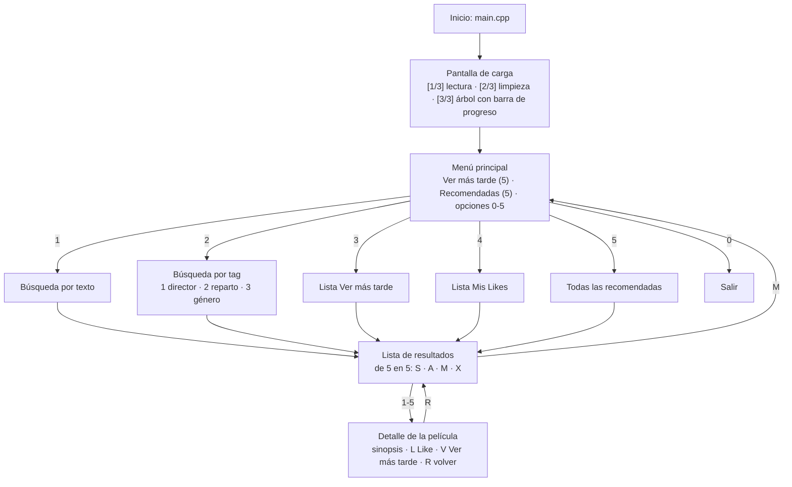

# Interfaz de usuario

**La interfaz es de terminal (texto), no gráfica.** Se maneja con menús numerados y letras, usando solo `iostream`, sin bibliotecas externas. Todo está en `src/05_interfaz_integracion/Interfaz.{h,cpp}`, con `ListasUsuario` (Like y Ver más tarde) y `Recomendador` en la misma carpeta.

Una captura completa de una sesión real está en [DEMO_TERMINAL.txt](DEMO_TERMINAL.txt).

---

## 1. Flujo general



### Pantalla de carga (`main.cpp`, `Interfaz::construirIndice`)

1. **[1/3] Lectura del CSV.** Lee `data/movies_clean.csv` (el CSV ya limpio, que está en Git). Con `--rebuild-clean` lee el original `data/wiki_movie_plots_deduped.csv`, muestra el informe de diagnóstico y lo vuelve a limpiar (ver [preprocesamiento.md](preprocesamiento.md)).
2. **[2/3] Limpieza.** "ya aplicada" si se usó el CSV limpio, o el informe de limpieza con `--rebuild-clean`.
3. **[3/3] Construcción del árbol.** El índice se construye en otro hilo (`Interfaz.cpp:164-208`) mientras el hilo principal dibuja una barra de 20 `#` con el avance real que informa el Observer de indexación (`BarraProgreso`, `Interfaz.cpp:137-160`). Si falta memoria, avisa y sugiere `--limite N`.

Luego pide Enter para ir al menú.

Opciones de línea de comandos (`main.cpp:33-67`): `--limite N` (usar solo las primeras N películas), `--hilos N` (hilos de indexación y búsqueda) y `--rebuild-clean`. Cualquier otra opción muestra el uso y termina.

---

## 2. Menú principal (`Interfaz::ejecutar`, `Interfaz.cpp:233-283`)

Arriba muestra:

- la cantidad de películas cargadas;
- **VER MAS TARDE**: hasta 5 películas de esa lista, la última agregada primero (`Interfaz.cpp:67`);
- **RECOMENDADAS PARA USTED**: las 5 con más puntaje y el total ("5 de 41"), calculadas a partir de los Likes (ver [algoritmos.md](algoritmos.md#3-recomendación-de-películas-similares)).

Si una lista está vacía, explica cómo llenarla ("Use [V] en el detalle de una pelicula", "De Like a una pelicula para recibir recomendaciones").

| Opción | Pantalla |
|---|---|
| 1 | Buscar por palabra, frase o parte de una palabra |
| 2 | Buscar por tag (director, reparto o género) |
| 3 | Ver más tarde (lista completa, paginada) |
| 4 | Mis Likes (lista completa, paginada) |
| 5 | Todas las recomendadas (paginada) |
| 0 | Salir |

Una opción inválida muestra "Opcion no valida. Escriba un numero del 0 al 5." y vuelve a pedir.

---

## 3. Búsquedas

### Por texto (`Interfaz::pantallaBusquedaTexto`, `Interfaz.cpp:316-335`)

Explica en pantalla que se puede escribir una palabra (`ship`), una frase (`ghost ship`) o parte de una palabra (`bar`), que una frase encuentra películas con **cualquiera** de sus palabras (primero las que tienen la frase completa, luego las que tienen todas las palabras y después las que tienen algunas) y que conviene buscar en inglés, porque las sinopsis están en inglés. Con texto vacío vuelve al menú. Busca en título, sinopsis, director, reparto y género.

### Por tag (`Interfaz::pantallaBusquedaTag`, `Interfaz.cpp:337-388`)

Submenú: 1 Director, 2 Reparto, 3 Género, 0 Volver. Pide el texto con un ejemplo (`spielberg`, `tom hanks`, `comedy, horror, western`). El texto debe aparecer completo y contiguo **dentro del campo elegido**.

Cómo se ordenan los resultados de ambas búsquedas: [algoritmos.md](algoritmos.md).

---

## 4. Lista de resultados y paginación (`Interfaz::mostrarLista`, `Interfaz.cpp:437-525`)

La usan las búsquedas y las listas del usuario (Ver más tarde, Likes, recomendadas).

```
 RESULTADOS PARA "ship"
 150 peliculas encontradas en 0.00 s   |   Pagina 1 de 30
--------------------------------------------------------------------------------
 1. 20,000 Leagues Under the Sea (1916)      | Stuart Paton       | action ad...
 ...
--------------------------------------------------------------------------------
 [1-5] Ver pelicula   [S] Siguientes 5   [M] Menu
```

- Cada fila: título con el año (40 columnas), director (18) y género (12), recortados con "..." sin cortar una letra con tilde (`Busqueda.cpp:65-67`, `recortar` en `src/comun/Utilidades.cpp`).
- **5 por página** (`POR_PAGINA`, `Interfaz.cpp:25`). La página se calcula como un rango del vector ya ordenado: cambiar de página es O(1) y no repite la búsqueda.
- **[1-5]** abre el detalle de esa película. **[S]** muestra las 5 siguientes y **[A]** las anteriores; en la última o la primera página avisa "Ya esta en la ultima/primera pagina". **[M]** vuelve al menú.
- En las búsquedas también se muestran la cantidad de resultados y el tiempo que tardó la búsqueda.

### Filtro [X]: ocultar las películas guardadas (Decorator)

En los resultados de una **búsqueda**, si el usuario tiene alguna película con Like o en Ver más tarde, aparece una línea más:

```
 [X] Ocultar las que tienen Like o estan en Ver mas tarde
```

Al elegirla, la misma búsqueda se repite envuelta en el decorador `FiltroExcluirClavesBusqueda` (`Interfaz::mostrarResultados`, `Interfaz.cpp:397-431`). El título pasa a `RESULTADOS PARA "ship" [Sin guardadas]` y la opción cambia a `[X] Mostrar tambien las guardadas`. Si el filtro deja la lista vacía, avisa ("Todas las peliculas de ... ya estan guardadas") y vuelve a la lista completa.

**Por defecto el filtro está desactivado**, y sin películas guardadas la opción no aparece. La opción se evalúa en cada redibujado: si el usuario da Like desde el detalle de esos mismos resultados, aparece al volver. Detalle del patrón en [patrones_diseno.md](patrones_diseno.md#3-decorator--decoradorbusqueda).

---

## 5. Detalle de una película (`Interfaz::mostrarDetalle`, `Interfaz.cpp:541-615`)

- Título y año, y los campos Estreno, Origen, Director, Reparto, Género y Wikipedia ("No registrado" si están vacíos).
- **SINOPSIS** ajustada a 78 columnas sin cortar palabras. Si es larga, se muestra en bloques de 18 líneas (`LINEAS_POR_BLOQUE`, `Interfaz.cpp:26`) con `[Enter] Seguir leyendo   [Q] Dejar de leer`.
- Acciones:
  - **[L] Like / [L] Quitar Like**: agrega o quita el Like y confirma ("Le dio Like a esta pelicula.").
  - **[V] Ver mas tarde / [V] Quitar de Ver mas tarde**: igual con la otra lista.
  - **[R] Volver a los resultados**: vuelve a la misma página de la lista.

El texto de [L] y [V] cambia según el estado actual de la película.

---

## 6. Like, Ver más tarde y persistencia (`ListasUsuario`)

- **Dónde se guarda:** `data/listas_usuario.txt`. La ruta se elige en `Interfaz::rutaListas` (`Interfaz.cpp:54-62`): si existe la carpeta `data/` en el directorio actual se usa esa; si no, `../data/` (por ejemplo, al ejecutar desde la carpeta del build); si no, el directorio actual. El archivo está en `.gitignore`: cada usuario tiene el suyo.
- **Cuándo:** se reescribe completo cada vez que se da o se quita un Like o un Ver más tarde (`ListasUsuario.cpp:46-58`). No hace falta salir del programa para que quede guardado.
- **Formato:** una línea por película, `L` o `V`, un tabulador y la clave de la película: título, año y página de Wikipedia separados por tabuladores (`ListasUsuario::clave`, `ListasUsuario.cpp:30-32`; escritura en `ListasUsuario.cpp:96-104`). Ejemplo:

  ```
  L	20,000 Leagues Under the Sea	1916	https://en.wikipedia.org/wiki/20,000_Leagues_Under_the_Sea_(1916_film)
  V	20,000 Leagues Under the Sea	1916	https://en.wikipedia.org/wiki/20,000_Leagues_Under_the_Sea_(1916_film)
  ```

- **Al iniciar** se lee el archivo (`ListasUsuario::cargar`, `ListasUsuario.cpp:77-94`). Las líneas rotas se ignoran y las repetidas no se duplican. Se usa la clave y no la posición en el catálogo porque la posición cambia con `--limite`; si una película guardada no está cargada (por ejemplo, con un `--limite` menor), simplemente no se muestra, pero sigue en el archivo.
- **Recomendaciones:** se recalculan solo cuando cambia la lista de Likes. `ListasUsuario` avisa a la `Interfaz` con el patrón Observer (`CacheRecomendadorObserver`, `Interfaz.cpp:46` y `Interfaz.cpp:79-91`).

---

## 7. Detalles de terminal

- **Limpiar la pantalla** (`Interfaz.cpp:105-116`): en una terminal real usa la secuencia ANSI `\033[2J\033[1;1H` (en Windows, `cls`). Si la salida no es una terminal (la consola de CLion, una redirección a archivo), solo deja una línea en blanco, para que la salida se pueda leer o comparar (así funciona el bench de sesión).
- **Tildes en Windows:** `prepararConsola` ejecuta `chcp 65001` para que la consola muestre UTF-8 (`Interfaz.cpp:98-103`).
- **Entrada:** cada respuesta se lee como una línea completa y se le quitan los espacios de los extremos (`Interfaz::leerLinea`, `Interfaz.cpp:211-225`). Si se cierra la entrada (Ctrl+D o fin de archivo), la pantalla actual termina en orden.
- **Ancho:** todas las pantallas usan 80 columnas (`ANCHO`, `Interfaz.cpp:24`).

## 8. Pruebas

- `interfaz_tests` (`tests/InterfazTests.cpp`): formato de filas (recortar, rellenar, ajustar texto), búsquedas y el orden de resultados.
- `interfaz_flujo_tests` (`tests/InterfazFlujoTests.cpp`): ejecuta la `Interfaz` real con entrada guionada. Comprueba el Like desde el detalle, las recomendaciones tras un Like, el filtro [X] y que sin películas guardadas la pantalla de resultados no cambia.
- `listas_usuario_tests` (`tests/ListasUsuarioTests.cpp`): guardar y volver a cargar Like y Ver más tarde, y el recomendador.
