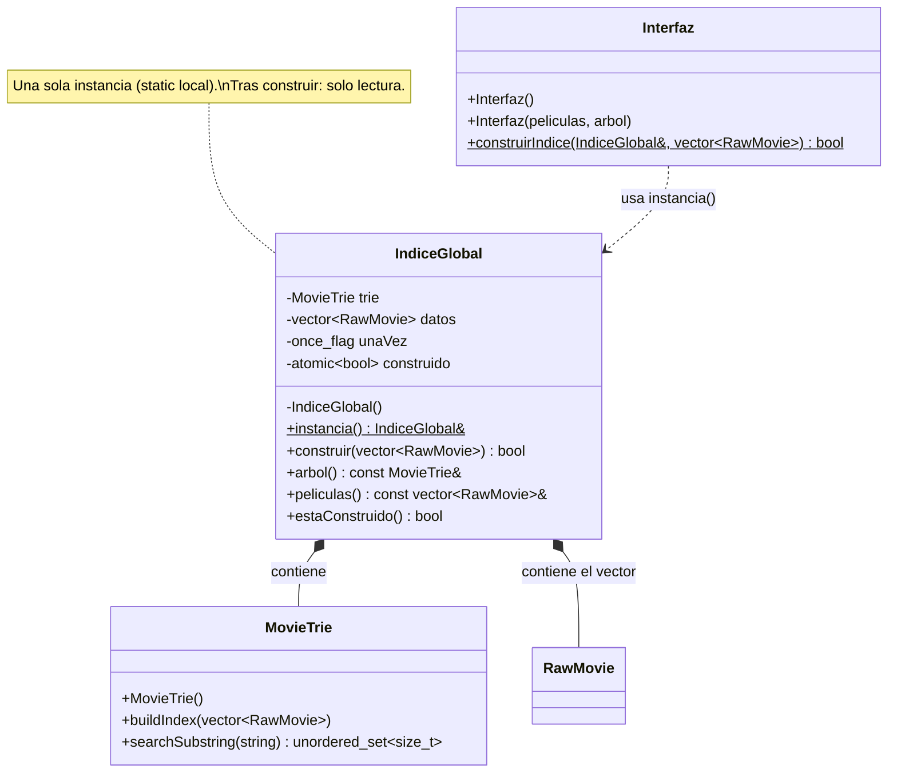
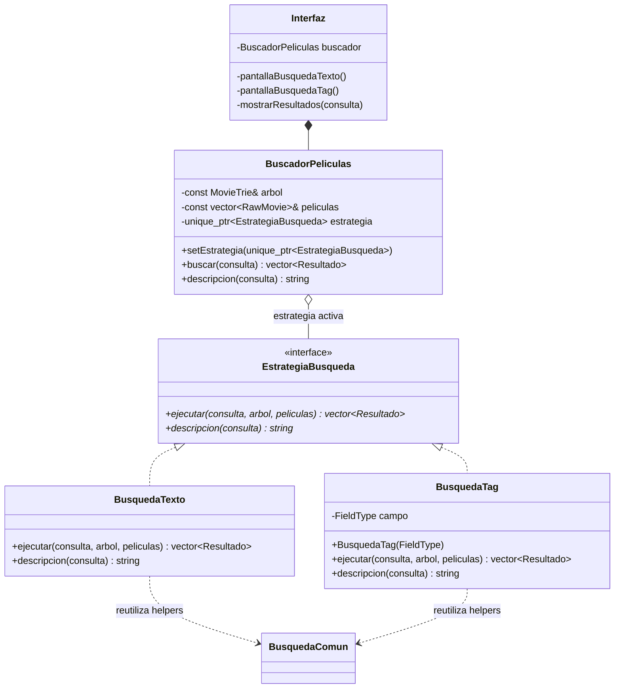

# Patrones de diseño — Parte 2

Plataforma de streaming de películas (C++20, CMake). En esta parte se aplicaron dos patrones:

| Patrón | Tipo | Clases principales | Carpeta |
|---|---|---|---|
| Singleton | Creacional | `IndiceGlobal` | `src/03_arbol_insercion/` |
| Strategy | De comportamiento | `EstrategiaBusqueda`, `BusquedaTexto`, `BusquedaTag`, `BuscadorPeliculas` | `src/04_busqueda/` |

Ninguno de los dos cambia el resultado de las búsquedas: se mantienen los puntajes, el orden, la normalización y la coincidencia contigua de frases. Para comprobarlo se comparó la salida del programa antes y después del cambio, con `--limite 1000` y con el dataset completo, y fue idéntica.

---

## 1. Singleton — `IndiceGlobal`

### Problema que resuelve

- El `MovieTrie` era una variable local de `main.cpp` (`MovieTrie trie;`). Se pasaba por referencia a `Interfaz::construirArbol` y a `Interfaz`, junto con el `std::vector<RawMovie> movies`, pero **por separado**.
- El Trie no guarda películas, guarda **posiciones del vector** (`TrieNode::movieIds`). Si el árbol y el vector se separan (otro vector, otro tamaño, otro orden), las búsquedas devuelven películas equivocadas sin dar ningún error. Lo único que lo evitaba era el chequeo `id >= peliculas.size()` en `Busqueda.cpp`.
- La indexación ocurre en otro hilo (`std::thread` en la pantalla de carga). Hacía falta garantizar que el índice se construya **una sola vez**, y que después solo se lea.

### Solución

`IndiceGlobal` (`src/03_arbol_insercion/IndiceGlobal.h/.cpp`) es el único índice de la aplicación. Guarda **juntos** el `MovieTrie` y el vector con el que se construyó.

| Clase / miembro | Rol |
|---|---|
| `IndiceGlobal::instancia()` | Punto de acceso global. Usa un `static` local (Meyers singleton): C++11 garantiza que se inicializa una sola vez aunque la llamen varios hilos. |
| `IndiceGlobal::construir(vector)` | Mueve las películas dentro del índice y construye el Trie dentro de `std::call_once`. Devuelve `true` solo en la llamada que indexó; las siguientes no reindexan. Si la indexación falla, el vector se vacía y se puede reintentar. |
| `arbol()` / `peliculas()` | Devuelven referencias **const**: después de construir, el estado es de solo lectura y es seguro leerlo desde varios hilos. Lanzan `std::logic_error` si se llaman antes de construir. |
| `estaConstruido()` | Consulta un `std::atomic<bool>`. |
| Constructor privado y copia/movimiento eliminados | Impiden crear una segunda instancia. |
| `MovieTrie` | **No cambia**: sigue teniendo constructor público. |
| `Interfaz()` | Constructor nuevo que toma el árbol y las películas del Singleton. |
| `Interfaz(peliculas, arbol)` | Constructor anterior: se mantiene para inyectar datos propios. |
| `Interfaz::construirIndice(indice, vector)` | Pantalla de carga: construye el Singleton en otro hilo mientras muestra el progreso. |



### Antes y después

**Antes** (`main.cpp`): el árbol y el vector viajan por separado.
```cpp
MovieTrie trie;
if (!Interfaz::construirArbol(trie, movies)) return 1;
Interfaz interfaz(movies, trie);
```

**Después**: un único índice con los dos juntos.
```cpp
IndiceGlobal& indice = IndiceGlobal::instancia();
if (!Interfaz::construirIndice(indice, std::move(movies))) return 1;
Interfaz interfaz; // usa IndiceGlobal::instancia()
```
```cpp
IndiceGlobal& IndiceGlobal::instancia() {
    static IndiceGlobal unica; // thread-safe desde C++11
    return unica;
}
```

### Por qué se eligió y qué se descartó

- **Se eligió** porque la aplicación necesita exactamente un índice. Además, el índice cuesta construirlo (memoria y tiempo) y debe quedar sincronizado con su vector de películas. Al guardar los dos en el mismo objeto, ya no se pueden desincronizar.
- **Meyers singleton (static local)** en lugar de un puntero estático con `new` y doble chequeo: el estándar ya garantiza la inicialización thread-safe, no hay que liberar memoria a mano y no hay riesgo de condiciones de carrera al crear la instancia.
- **Descartado: convertir `MovieTrie` en Singleton.** Haría falta privatizar su constructor. Con eso ya no se podrían crear Tries locales en las pruebas (`InterfazTests` construye su propio árbol con 5 películas y otro para probar la reconstrucción), y todo el código quedaría atado a un único árbol global. `IndiceGlobal` es solo un **contenedor**: el Trie sigue siendo una clase normal que se puede inyectar.
- **Descartado: una variable global** (`MovieTrie g_trie;`). No controla cuántas veces se indexa, no protege contra hilos y permite modificar el árbol desde cualquier parte. El Singleton expone solo referencias `const`.

### Cómo se probó

Prueba `indice_global_tests` (`tests/IndiceGlobalTests.cpp`). Es un ejecutable aparte para que el estado global no afecte a las demás pruebas.
- `instancia()` devuelve siempre el mismo objeto, también desde otro hilo.
- Antes de construir, `estaConstruido()` es `false` y `arbol()` lanza `logic_error`.
- 8 hilos llaman a `construir()` a la vez y **solo uno** indexa.
- Una segunda llamada a `construir()` con otros datos devuelve `false`: las películas y el árbol no cambian.
- Un `MovieTrie` local se construye por su cuenta sin afectar al Singleton (inyección en pruebas).

Además, `interfaz_tests` sigue usando Tries locales, y la salida del programa es idéntica a la de antes del cambio.

---

## 2. Strategy — `EstrategiaBusqueda`

### Problema que resuelve

- Había una jerarquía `Busqueda` → `BusquedaTexto` / `BusquedaTag`, pero cada objeto **guardaba la consulta** (`texto`, `textoNormalizado`). Por eso había que crear un objeto nuevo por búsqueda, y el algoritmo quedaba mezclado con los datos de una consulta concreta.
- `Interfaz` creaba directamente las clases concretas (`BusquedaTexto busqueda(texto);` en `pantallaBusquedaTexto` y `BusquedaTag busqueda(campo, texto);` en `pantallaBusquedaTag`) y además guardaba una referencia al Trie solo para pasársela a cada búsqueda.
- Los helpers de puntaje (`separarTerminos`, `contiene`, `puntajeTexto`, `puntajeCampo`) estaban en un namespace anónimo de `Busqueda.cpp`, así que ningún otro archivo los podía reutilizar.

### Solución

| Clase | Rol en Strategy | Archivo |
|---|---|---|
| `EstrategiaBusqueda` | **Strategy** (interfaz): `ejecutar(consulta, arbol, peliculas)` y `descripcion(consulta)`. | `src/04_busqueda/EstrategiaBusqueda.h` |
| `BusquedaTexto` | **Estrategia concreta**: palabra, sub-palabra o frase contigua en cualquier campo. | `src/04_busqueda/Busqueda.h/.cpp` |
| `BusquedaTag` | **Estrategia concreta**: frase dentro de un campo (`FieldType`: director, reparto, género). | `src/04_busqueda/Busqueda.h/.cpp` |
| `BuscadorPeliculas` | **Contexto**: guarda la estrategia activa (`unique_ptr`), permite cambiarla con `setEstrategia` y delega en ella `buscar` y `descripcion`. Recibe el árbol y las películas por inyección. | `src/04_busqueda/BuscadorPeliculas.h/.cpp` |
| `Interfaz` | **Cliente**: elige la estrategia según la opción del menú. | `src/05_interfaz_integracion/Interfaz.cpp` |
| `busqueda_interna::*` | Helpers compartidos (puntajes, normalización de términos, `crearResultado`), movidos sin cambios. | `src/04_busqueda/BusquedaComun.h/.cpp` |



### Antes y después

**Antes** (`Interfaz.cpp`): la interfaz crea la clase concreta, que guarda la consulta.
```cpp
BusquedaTexto busqueda(texto);
mostrarResultados(busqueda);          // busqueda.ejecutar(arbol, peliculas)

BusquedaTag busqueda(campo, texto);
mostrarResultados(busqueda);
```

**Después**: la interfaz elige una estrategia y el contexto delega en ella.
```cpp
buscador.setEstrategia(std::make_unique<BusquedaTexto>());
mostrarResultados(texto);             // buscador.buscar(texto)

buscador.setEstrategia(std::make_unique<BusquedaTag>(campo));
mostrarResultados(texto);
```
```cpp
std::vector<Resultado> BuscadorPeliculas::buscar(const std::string& consulta) const {
    return estrategia->ejecutar(consulta, arbol, peliculas);
}
```

### Por qué se eligió y qué se descartó

- **Se eligió** porque el programa tiene varios algoritmos de búsqueda que se intercambian según lo que elige el usuario en el menú, y todos devuelven lo mismo (`std::vector<Resultado>` ordenado). Con Strategy, la interfaz no depende de cómo se calcula cada búsqueda, y para agregar una nueva solo hay que crear otra clase, sin tocar `mostrarResultados`.
- **La consulta pasa a ser un parámetro**: la estrategia es un algoritmo sin estado (solo `BusquedaTag` guarda su campo, que es su configuración). Así una misma estrategia sirve para muchas búsquedas.
- **El árbol y las películas se inyectan** en el contexto: en la aplicación vienen del Singleton `IndiceGlobal` y en las pruebas, de un Trie local. Los dos patrones se combinan sin acoplarse.
- **Descartado: un `switch`/`if` sobre el tipo de búsqueda** dentro de `Interfaz` o de una función `buscar(tipo, ...)`. Cada búsqueda nueva obligaría a modificar esa función (rompe abierto/cerrado) y mezclaría la lógica de la interfaz con la del motor.
- **Descartado: una tercera clase `BusquedaFrase` separada.** Hoy "frase" usa el mismo algoritmo que "palabra" (coincidencia contigua del texto completo), así que esa clase repetiría código. Si en el futuro la frase se calcula de otra forma, basta con agregarla como otra estrategia.
- **Descartado: reescribir los algoritmos.** Los cuerpos de `ejecutar` y los helpers se movieron sin cambios, para garantizar los mismos puntajes y el mismo orden.

### Cómo se probó

Prueba `interfaz_tests` (`tests/InterfazTests.cpp`):
- Todas las pruebas de búsqueda anteriores pasan con la nueva firma (`BusquedaTexto().ejecutar("ship", arbol, peliculas)`): orden por prioridad, mayúsculas, sub-palabra, frase contigua, rechazo de palabras separadas, falso positivo del trigrama, tags por director, reparto y género.
- Polimorfismo a través de `std::unique_ptr<EstrategiaBusqueda>` y `descripcion(consulta)`.
- **Cambio de estrategia en tiempo de ejecución**: con el mismo `BuscadorPeliculas`, la consulta `"ford"` devuelve 2 películas con `BusquedaTexto`, *Blue Sky* con `BusquedaTag(DIRECTOR)` y *Harbor* con `BusquedaTag(CAST)`.
- Buscar sin estrategia lanza `std::logic_error`.
- El contexto devuelve exactamente lo mismo (ids y prioridades) que la estrategia usada directamente.

---

## 3. Guía de exposición

### Singleton

1. `main.cpp`, bloque de "Singleton": cómo se obtiene `IndiceGlobal::instancia()` y se construye el índice.
2. `src/03_arbol_insercion/IndiceGlobal.h`: constructor privado, copia eliminada, comentario sobre hilos y solo lectura.
3. `src/03_arbol_insercion/IndiceGlobal.cpp`: `static IndiceGlobal unica;` y `std::call_once` en `construir`.
4. `src/05_interfaz_integracion/Interfaz.cpp`: `Interfaz()` usa el Singleton y `construirIndice` lo construye en otro hilo.
5. `tests/IndiceGlobalTests.cpp`: misma instancia, 8 hilos indexan una sola vez y Trie local inyectable.

**Pregunta probable:** *"¿Por qué no hicieron que `MovieTrie` fuera el Singleton?"*
**Respuesta:** Porque habría que privatizar su constructor, y entonces las pruebas no podrían crear Tries pequeños y distintos (`InterfazTests` arma uno con 5 películas). Además, el problema real era mantener el árbol sincronizado con su vector de películas, y eso se resuelve guardándolos juntos en `IndiceGlobal`. El Trie sigue siendo una clase normal que se puede inyectar, y el Singleton solo controla que en la aplicación haya un índice, construido una sola vez y de solo lectura.

### Strategy

1. `src/04_busqueda/EstrategiaBusqueda.h`: la interfaz con `ejecutar(consulta, ...)` y `descripcion(consulta)`.
2. `src/04_busqueda/Busqueda.h`: las dos estrategias concretas, `BusquedaTexto` y `BusquedaTag(FieldType)`.
3. `src/04_busqueda/BuscadorPeliculas.h/.cpp`: el contexto con `setEstrategia` y `buscar`, que delega.
4. `src/05_interfaz_integracion/Interfaz.cpp`: `pantallaBusquedaTexto` y `pantallaBusquedaTag` eligen la estrategia y `mostrarResultados` solo llama a `buscador.buscar`.
5. `tests/InterfazTests.cpp`: la prueba "ford" cambia de estrategia en tiempo de ejecución y el resultado cambia.

**Pregunta probable:** *"Ya tenían herencia con `Busqueda`; ¿qué cambió realmente?"*
**Respuesta:** Antes cada objeto de búsqueda guardaba la consulta, así que era "una búsqueda concreta", no "un algoritmo", y la interfaz creaba directamente las clases concretas. Ahora la estrategia es solo el algoritmo y recibe la consulta por parámetro. Existe un contexto (`BuscadorPeliculas`) que guarda la estrategia activa y la puede cambiar en tiempo de ejecución, y la interfaz solo habla con el contexto. Para agregar un nuevo tipo de búsqueda basta con crear otra clase que implemente `EstrategiaBusqueda`, sin modificar `mostrarResultados`.
