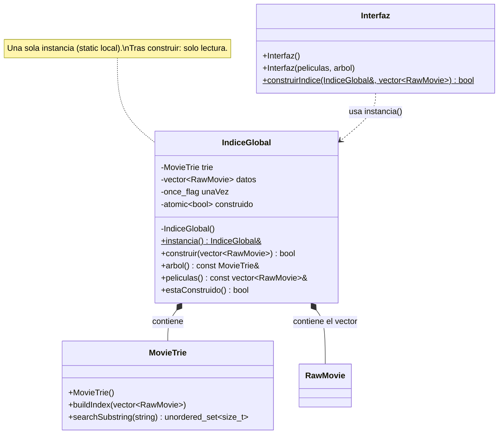
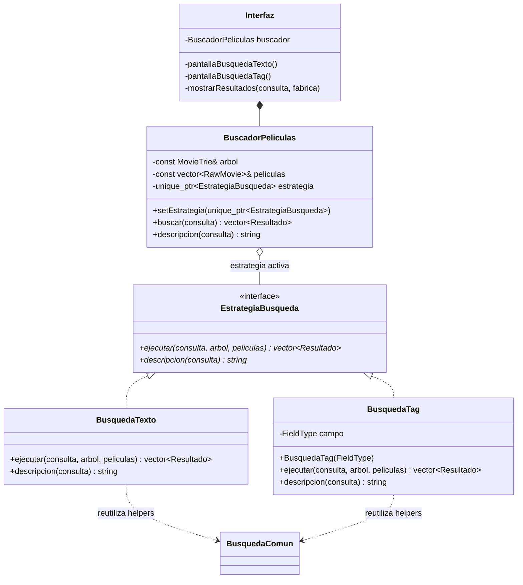
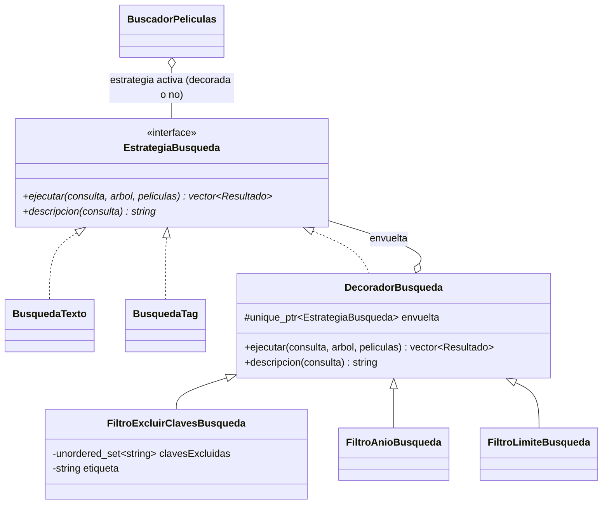

# Patrones de diseño — Parte 2

Plataforma de streaming de películas (C++20, CMake). Se aplicaron **cuatro patrones**, y los cuatro se usan en la aplicación real (no solo en las pruebas):

| # | Patrón | Tipo | Clases principales | Dónde se usa en la app |
|---|---|---|---|---|
| 1 | Singleton | Creacional | `IndiceGlobal` | `main.cpp` obtiene `IndiceGlobal::instancia()` y `Interfaz::construirIndice` lo construye; `Interfaz()` lee el árbol y las películas de ahí. |
| 2 | Strategy | De comportamiento | `EstrategiaBusqueda`, `BusquedaTexto`, `BusquedaTag`, `BuscadorPeliculas` | `Interfaz::pantallaBusquedaTexto` / `pantallaBusquedaTag` eligen la estrategia y `Interfaz::mostrarResultados` busca a través del contexto `BuscadorPeliculas`. |
| 3 | Decorator | Estructural | `DecoradorBusqueda`, `FiltroExcluirClavesBusqueda` (y `FiltroAnioBusqueda`, `FiltroLimiteBusqueda`) | Opción **[X]** en los resultados de una búsqueda: `Interfaz::mostrarResultados` envuelve la estrategia en `FiltroExcluirClavesBusqueda` para ocultar las películas con Like o en Ver más tarde. |
| 4 | Observer | De comportamiento | a) `IObserverLista`, `ListasUsuario`, `CacheRecomendadorObserver` · b) `IObservadorIndexacion`, `MovieTrie`, `BarraProgreso` | a) `Interfaz` se suscribe a `ListasUsuario`: cada Like invalida la caché de recomendaciones. b) La barra de progreso de la pantalla de carga recibe el avance de `MovieTrie::buildIndex`. |

Archivos: `src/03_arbol_insercion/` (Singleton y Observer de indexación), `src/04_busqueda/` (Strategy y Decorator) y `src/05_interfaz_integracion/` (Observer de listas y uso de todos en `Interfaz`).

Singleton y Strategy no cambiaron el resultado de las búsquedas: para comprobarlo se comparó la salida del programa antes y después de aplicarlos, con `--limite 1000` y con el dataset completo, y fue idéntica. (La semántica de las frases cambió después, por separado, para cumplir el "y/o" del enunciado; ver `prioridadTexto` en `src/04_busqueda/BusquedaComun.h`.) Decorator y Observer de listas tampoco cambian el comportamiento por defecto: el filtro [X] empieza desactivado y solo se ofrece si hay películas guardadas, y las recomendaciones son las mismas que antes.

---

## 1. Singleton — `IndiceGlobal`

### Problema que resuelve

- El `MovieTrie` era una variable local de `main.cpp` (`MovieTrie trie;`). Se pasaba por referencia a `Interfaz::construirArbol` y a `Interfaz`, junto con el `std::vector<RawMovie> movies`, pero **por separado**.
- El Trie no guarda películas, guarda **posiciones del vector** (`TrieNode::movieIds`). Si el árbol y el vector se separan (otro vector, otro tamaño, otro orden), las búsquedas devuelven películas equivocadas sin dar ningún error. Lo único que lo evitaba era el chequeo `id >= peliculas.size()` en `Busqueda.cpp`.
- La indexación ocurre en otro hilo (`std::thread` en la pantalla de carga). Hacía falta garantizar que el índice se construya **una sola vez**, y que después solo se lea.

### Solución

`IndiceGlobal` (`src/03_arbol_insercion/IndiceGlobal.h/.cpp`) es el único índice de la aplicación. Guarda **juntos** el `MovieTrie` y el vector con el que se construyó.

| Clase / miembro | Rol |
|---|---|
| `IndiceGlobal::instancia()` | Punto de acceso global. Usa un `static` local (Meyers singleton): C++11 garantiza que se inicializa una sola vez aunque la llamen varios hilos. |
| `IndiceGlobal::construir(vector)` | Mueve las películas dentro del índice y construye el Trie dentro de `std::call_once`. Devuelve `true` solo en la llamada que indexó; las siguientes no reindexan. Si la indexación falla, el vector se vacía y se puede reintentar. |
| `arbol()` / `peliculas()` | Devuelven referencias **const**: después de construir, el estado es de solo lectura y es seguro leerlo desde varios hilos. Lanzan `std::logic_error` si se llaman antes de construir. |
| `estaConstruido()` | Consulta un `std::atomic<bool>`. |
| Constructor privado y copia/movimiento eliminados | Impiden crear una segunda instancia. |
| `MovieTrie` | **No cambia**: sigue teniendo constructor público. |
| `Interfaz()` | Constructor nuevo que toma el árbol y las películas del Singleton. |
| `Interfaz(peliculas, arbol)` | Constructor anterior: se mantiene para inyectar datos propios. |
| `Interfaz::construirIndice(indice, vector)` | Pantalla de carga: construye el Singleton en otro hilo mientras muestra el progreso. |



### Antes y después

**Antes** (`main.cpp`): el árbol y el vector viajan por separado.
```cpp
MovieTrie trie;
if (!Interfaz::construirArbol(trie, movies)) return 1;
Interfaz interfaz(movies, trie);
```

**Después**: un único índice con los dos juntos.
```cpp
IndiceGlobal& indice = IndiceGlobal::instancia();
if (!Interfaz::construirIndice(indice, std::move(movies))) return 1;
Interfaz interfaz; // usa IndiceGlobal::instancia()
```
```cpp
IndiceGlobal& IndiceGlobal::instancia() {
    static IndiceGlobal unica; // thread-safe desde C++11
    return unica;
}
```

### Por qué se eligió y qué se descartó

- **Se eligió** porque la aplicación necesita exactamente un índice. Además, el índice cuesta construirlo (memoria y tiempo) y debe quedar sincronizado con su vector de películas. Al guardar los dos en el mismo objeto, ya no se pueden desincronizar.
- **Meyers singleton (static local)** en lugar de un puntero estático con `new` y doble chequeo: el estándar ya garantiza la inicialización thread-safe, no hay que liberar memoria a mano y no hay riesgo de condiciones de carrera al crear la instancia.
- **Descartado: convertir `MovieTrie` en Singleton.** Haría falta privatizar su constructor. Con eso ya no se podrían crear Tries locales en las pruebas (`InterfazTests` construye su propio árbol con 5 películas y otro para probar la reconstrucción), y todo el código quedaría atado a un único árbol global. `IndiceGlobal` es solo un **contenedor**: el Trie sigue siendo una clase normal que se puede inyectar.
- **Descartado: una variable global** (`MovieTrie g_trie;`). No controla cuántas veces se indexa, no protege contra hilos y permite modificar el árbol desde cualquier parte. El Singleton expone solo referencias `const`.

### Cómo se probó

Prueba `indice_global_tests` (`tests/IndiceGlobalTests.cpp`). Es un ejecutable aparte para que el estado global no afecte a las demás pruebas.
- `instancia()` devuelve siempre el mismo objeto, también desde otro hilo.
- Antes de construir, `estaConstruido()` es `false` y `arbol()` lanza `logic_error`.
- 8 hilos llaman a `construir()` a la vez y **solo uno** indexa.
- Una segunda llamada a `construir()` con otros datos devuelve `false`: las películas y el árbol no cambian.
- Un `MovieTrie` local se construye por su cuenta sin afectar al Singleton (inyección en pruebas).

Además, `interfaz_tests` sigue usando Tries locales, y la salida del programa es idéntica a la de antes del cambio.

---

## 2. Strategy — `EstrategiaBusqueda`

### Problema que resuelve

- Había una jerarquía `Busqueda` → `BusquedaTexto` / `BusquedaTag`, pero cada objeto **guardaba la consulta** (`texto`, `textoNormalizado`). Por eso había que crear un objeto nuevo por búsqueda, y el algoritmo quedaba mezclado con los datos de una consulta concreta.
- `Interfaz` creaba directamente las clases concretas (`BusquedaTexto busqueda(texto);` en `pantallaBusquedaTexto` y `BusquedaTag busqueda(campo, texto);` en `pantallaBusquedaTag`) y además guardaba una referencia al Trie solo para pasársela a cada búsqueda.
- Los helpers de puntaje (`separarTerminos`, `contiene`, `puntajeTexto`, `puntajeCampo`) estaban en un namespace anónimo de `Busqueda.cpp`, así que ningún otro archivo los podía reutilizar.

### Solución

| Clase | Rol en Strategy | Archivo |
|---|---|---|
| `EstrategiaBusqueda` | **Strategy** (interfaz): `ejecutar(consulta, arbol, peliculas)` y `descripcion(consulta)`. | `src/04_busqueda/EstrategiaBusqueda.h` |
| `BusquedaTexto` | **Estrategia concreta**: palabra, sub-palabra o frase ("y/o": cualquiera de sus palabras, primero la frase contigua) en cualquier campo. | `src/04_busqueda/Busqueda.h/.cpp` |
| `BusquedaTag` | **Estrategia concreta**: frase dentro de un campo (`FieldType`: director, reparto, género). | `src/04_busqueda/Busqueda.h/.cpp` |
| `BuscadorPeliculas` | **Contexto**: guarda la estrategia activa (`unique_ptr`), permite cambiarla con `setEstrategia` y delega en ella `buscar` y `descripcion`. Recibe el árbol y las películas por inyección. | `src/04_busqueda/BuscadorPeliculas.h/.cpp` |
| `Interfaz` | **Cliente**: elige la estrategia según la opción del menú. | `src/05_interfaz_integracion/Interfaz.cpp` |
| `busqueda_interna::*` | Helpers compartidos (puntajes, normalización de términos, `crearResultado`), movidos sin cambios. | `src/04_busqueda/BusquedaComun.h/.cpp` |



### Antes y después

**Antes** (`Interfaz.cpp`): la interfaz crea la clase concreta, que guarda la consulta.
```cpp
BusquedaTexto busqueda(texto);
mostrarResultados(busqueda);          // busqueda.ejecutar(arbol, peliculas)

BusquedaTag busqueda(campo, texto);
mostrarResultados(busqueda);
```

**Después**: la interfaz elige una estrategia y el contexto delega en ella. `mostrarResultados` recibe una *fábrica* de la estrategia para poder decorarla (sección 3) antes de pasarla al contexto.
```cpp
mostrarResultados(texto, []() { return std::make_unique<BusquedaTexto>(); });
mostrarResultados(texto, [campo]() { return std::make_unique<BusquedaTag>(campo); });

// dentro de mostrarResultados:
buscador.setEstrategia(fabrica());    // o la misma estrategia envuelta en un decorador
resultados = buscador.buscar(consulta);
```
```cpp
std::vector<Resultado> BuscadorPeliculas::buscar(const std::string& consulta) const {
    return estrategia->ejecutar(consulta, arbol, peliculas);
}
```

### Por qué se eligió y qué se descartó

- **Se eligió** porque el programa tiene varios algoritmos de búsqueda que se intercambian según lo que elige el usuario en el menú, y todos devuelven lo mismo (`std::vector<Resultado>` ordenado). Con Strategy, la interfaz no depende de cómo se calcula cada búsqueda, y para agregar una nueva solo hay que crear otra clase, sin tocar `mostrarResultados`.
- **La consulta pasa a ser un parámetro**: la estrategia es un algoritmo sin estado (solo `BusquedaTag` guarda su campo, que es su configuración). Así una misma estrategia sirve para muchas búsquedas.
- **El árbol y las películas se inyectan** en el contexto: en la aplicación vienen del Singleton `IndiceGlobal` y en las pruebas, de un Trie local. Singleton y Strategy se combinan sin acoplarse.
- **Descartado: un `switch`/`if` sobre el tipo de búsqueda** dentro de `Interfaz` o de una función `buscar(tipo, ...)`. Cada búsqueda nueva obligaría a modificar esa función (rompe abierto/cerrado) y mezclaría la lógica de la interfaz con la del motor.
- **Descartado: una tercera clase `BusquedaFrase` separada.** "Frase" y "palabra" comparten el algoritmo: una palabra es una frase de un solo término, y con la búsqueda "y/o" la frase se resuelve en `BusquedaTexto` con la misma unión de candidatos y la misma prioridad por niveles. Una clase aparte repetiría código.
- **Descartado: reescribir los algoritmos.** Los cuerpos de `ejecutar` y los helpers se movieron sin cambios, para garantizar los mismos puntajes y el mismo orden.

### Cómo se probó

Prueba `interfaz_tests` (`tests/InterfazTests.cpp`):
- Todas las pruebas de búsqueda pasan con la nueva firma (`BusquedaTexto().ejecutar("ship", arbol, peliculas)`): orden por prioridad, mayúsculas, sub-palabra, frase "y/o" (contigua primero), falso positivo del trigrama, tags por director, reparto y género.
- Polimorfismo a través de `std::unique_ptr<EstrategiaBusqueda>` y `descripcion(consulta)`.
- **Cambio de estrategia en tiempo de ejecución**: con el mismo `BuscadorPeliculas`, la consulta `"ford"` devuelve 2 películas con `BusquedaTexto`, *Blue Sky* con `BusquedaTag(DIRECTOR)` y *Harbor* con `BusquedaTag(CAST)`.
- Buscar sin estrategia lanza `std::logic_error`.
- El contexto devuelve exactamente lo mismo (ids y prioridades) que la estrategia usada directamente.

---

## 3. Decorator — `DecoradorBusqueda`

### Problema que resuelve

- Las estrategias base (`BusquedaTexto` y `BusquedaTag`) devuelven los resultados ordenados por relevancia. A veces se quiere **restringir** esos resultados (ocultar las películas que el usuario ya guardó, filtrar por años, quedarse con el Top-N) sin cambiar el algoritmo de búsqueda.
- Con herencia habría que crear una subclase por combinación (`BusquedaTextoSinGuardadas`, `BusquedaTagPorAnioSinGuardadas`, ...): explosión de clases y cambios en código ya probado.

### Solución

Cada decorador **es** una `EstrategiaBusqueda` y **contiene** otra: ejecuta la envuelta y filtra lo que devuelve (`src/04_busqueda/DecoradorBusqueda.h/.cpp`).

| Clase | Rol en Decorator | Responsabilidad |
|---|---|---|
| `EstrategiaBusqueda` | **Component** (interfaz) | Contrato común (`ejecutar` y `descripcion`) de estrategias y decoradores. |
| `BusquedaTexto` / `BusquedaTag` | **ConcreteComponent** | La búsqueda base sobre el `MovieTrie`. |
| `DecoradorBusqueda` | **Decorator** (base) | Guarda un `std::unique_ptr<EstrategiaBusqueda>` y delega en él. |
| `FiltroExcluirClavesBusqueda` | **ConcreteDecorator** (*usado en la app*) | Quita las películas cuya clave (título, año y página de Wikipedia, el mismo formato que `ListasUsuario::clave`) está en un conjunto. Agrega `[Sin <etiqueta>]` a la descripción. |
| `FiltroAnioBusqueda` | **ConcreteDecorator** | Conserva las películas estrenadas en `[anioMin, anioMax]`. Hoy solo se usa en las pruebas. |
| `FiltroLimiteBusqueda` | **ConcreteDecorator** | Recorta a los primeros N resultados. Hoy solo se usa en las pruebas. |

### Dónde se usa en la app

En la pantalla de resultados de una búsqueda (texto o tag), si el usuario tiene alguna película con Like o en Ver más tarde aparece la opción:

```
 [X] Ocultar las que tienen Like o estan en Ver mas tarde
```

Al elegirla, `Interfaz::mostrarResultados` vuelve a crear la misma estrategia y la **envuelve** antes de dársela al contexto:

```cpp
std::unique_ptr<EstrategiaBusqueda> estrategia = fabrica();      // BusquedaTexto o BusquedaTag
if (ocultarGuardadas) {
    estrategia = std::make_unique<FiltroExcluirClavesBusqueda>(std::move(estrategia),
                                                               clavesGuardadas(), "guardadas");
}
buscador.setEstrategia(std::move(estrategia));
resultados = buscador.buscar(consulta);   // título: RESULTADOS PARA "ship" [Sin guardadas]
```

`[X]` otra vez (`[X] Mostrar tambien las guardadas`) vuelve a la lista completa. Si el filtro deja la lista vacía, se avisa ("Todas las peliculas de ... ya estan guardadas") y se muestra la lista completa. **Por defecto el filtro está desactivado**, y sin películas guardadas la opción ni siquiera aparece, así que la pantalla de resultados es la de siempre.



### Por qué se eligió y qué se descartó

- **Se eligió** porque el contexto `BuscadorPeliculas` recibe un `std::unique_ptr<EstrategiaBusqueda>`: acepta una estrategia decorada sin cambiar el contexto ni las estrategias base. Los decoradores se pueden apilar (en las pruebas: texto → año → excluir → Top 1).
- **Combina con Strategy:** la `Interfaz` elige la estrategia (Strategy) y, aparte, decide si la envuelve (Decorator). Por eso `mostrarResultados` recibe una fábrica de estrategias en lugar de una estrategia ya creada.
- **Descartado:** agregar parámetros opcionales (`anioMin`, `limite`, `excluidas`) a `EstrategiaBusqueda::ejecutar`. Obligaría a cambiar todas las estrategias y sus pruebas.
- **Descartado:** filtrar dentro de `Interfaz` con un bucle propio. Funcionaría, pero mezcla la lógica de la búsqueda con la de la pantalla y no se puede reutilizar ni combinar con otros filtros.

### Cómo se probó

- `patrones_3_4_tests` (`tests/Patrones34Tests.cpp`): filtro por año, decoradores apilados (año → excluir → límite) y la descripción decorada.
- `interfaz_flujo_tests` (`tests/InterfazFlujoTests.cpp`): ejecuta la `Interfaz` real con entrada guionada. Sin nada guardado no aparece `[X]`; tras dar Like aparece; `[X]` muestra `RESULTADOS PARA "ship" [Sin guardadas]` con una película menos; `[X]` otra vez vuelve a mostrar todas; y si el filtro deja la lista vacía se avisa.

---

## 4. Observer

El patrón se aplica en dos lugares con el mismo esquema: un **sujeto** que no sabe a quién avisa y **observadores** que implementan una interfaz.

### 4.1 Observer de listas — `IObserverLista`

#### Problema que resuelve

- `ListasUsuario` guarda los Likes y Ver más tarde (persistidos en `data/listas_usuario.txt`).
- La `Interfaz` guarda en caché las recomendaciones, porque calcularlas recorre todo el catálogo. Cuando cambian los Likes, la caché queda vieja. Antes la `Interfaz` lo resolvía a mano con un booleano (`recomendadasAlDia = false` después de cada Like): cualquier otro lugar que cambiara las listas tenía que acordarse de hacerlo.
- Si `ListasUsuario` llamara directamente al recomendador, quedaría acoplado al catálogo y a la lógica de puntaje.

#### Solución

`src/05_interfaz_integracion/ObserverLista.h` y `ListasUsuario.h/.cpp`:

| Clase / método | Rol en Observer | Responsabilidad |
|---|---|---|
| `IObserverLista` | **Observer** (interfaz) | `onCambioLista(TipoListaUsuario, clavePelicula, agregada)`. |
| `ListasUsuario` | **Subject** | `agregarObservador` / `eliminarObservador`; `notificar(...)` después de cada `alternarLike` y `alternarVerMasTarde`. |
| `CacheRecomendadorObserver` | **ConcreteObserver** (*usado en la app*) | Invalida la caché cuando cambia la lista de Likes. Las recomendaciones dependen solo de los Likes: un cambio en Ver más tarde se notifica, pero no la invalida. |
| `AuditorListasObserver` | **ConcreteObserver** | Bitácora de acciones de la sesión. Hoy solo se usa en las pruebas. |

#### Dónde se usa en la app

`Interfaz` tiene un miembro `CacheRecomendadorObserver cacheRecomendadas`. En el constructor se suscribe a sus `ListasUsuario` y en el destructor se desuscribe (por eso `Interfaz` no se puede copiar):

```cpp
listas.agregarObservador(&cacheRecomendadas);          // Interfaz::Interfaz

if (!cacheRecomendadas.estaActualizada()) {            // Interfaz::obtenerRecomendadas
    recomendadas = Recomendador::recomendar(peliculas, idsConLike);
    cacheRecomendadas.marcarActualizada();
}

listas.alternarLike(clave);   // Interfaz::mostrarDetalle: ListasUsuario notifica y la caché se invalida
```

La caché empieza inválida, así que la primera vez se calcula; después solo se recalcula cuando un Like la invalida.

#### Por qué se eligió y qué se descartó

- **Se eligió** porque separa "guardar la preferencia" de "lo que pasa cuando cambia": se pueden agregar reacciones (por ejemplo, la bitácora) sin tocar `ListasUsuario` ni la `Interfaz`.
- **Descartado:** recalcular las recomendaciones dentro de `ListasUsuario::alternarLike()`. `ListasUsuario` tendría que conocer el catálogo y el `Recomendador`.
- **Descartado:** el booleano manual de antes. Funcionaba, pero dependía de que cada lugar que cambia los Likes se acordara de invalidarlo.

#### Cómo se probó

- `patrones_3_4_tests`: un Like invalida la caché y queda en la bitácora; Ver más tarde no invalida pero sí se registra; un observador desuscrito deja de recibir avisos.
- `interfaz_flujo_tests`: con la `Interfaz` real, antes del Like la pantalla de inicio dice "De Like a una pelicula para recibir recomendaciones" y después del Like muestra recomendaciones.

### 4.2 Observer de indexación — `IObservadorIndexacion` (barra de progreso)

#### Problema que resuelve

Construir el índice del catálogo completo tarda varios segundos. La pantalla de carga necesita mostrar el avance **real**, pero `MovieTrie` no debe saber nada de la consola, y la indexación es paralela: varios hilos insertan a la vez.

#### Solución

| Clase / método | Rol en Observer | Responsabilidad |
|---|---|---|
| `IObservadorIndexacion` (`src/03_arbol_insercion/ObservadorIndexacion.h`) | **Observer** (interfaz) | `onProgresoIndexacion(procesadas, total)`, medido en claves insertadas. |
| `MovieTrie::buildIndex(peliculas, hilos, observador)` | **Subject** | Notifica el avance; la última notificación es siempre `(total, total)`. |
| `IndiceGlobal::construir(peliculas, observador)` | Intermediario | Pasa el observador al Trie dentro de `call_once`. |
| `BarraProgreso` (en `Interfaz.cpp`) | **ConcreteObserver** (*usado en la app*) | Guarda el avance en atómicos; el hilo principal dibuja la barra `####...` cada 100 ms. |

**Garantía de hilos:** `buildIndex` llama al observador **siempre desde el hilo que lo invocó**, nunca desde los hilos trabajadores ni de forma concurrente. Los trabajadores solo incrementan un `std::atomic`; el hilo que llamó lo lee periódicamente y notifica. Así un observador no necesita locks. Detalle en [programacion_paralela.md, sección 2.4](programacion_paralela.md#24-observer-de-progreso-contador-atómico-y-un-solo-hilo-que-notifica).

#### Dónde se usa en la app

`Interfaz::construirIndice` crea una `BarraProgreso`, lanza `indice.construir(std::move(peliculas), &barra)` en otro hilo y, mientras tanto, dibuja la barra con `barra.marcas()`:

```
 [3/3] Construccion del arbol ........ #################### listo, 34886 peliculas (8.31 s)
```

#### Cómo se probó

`paralelo_tests` (`tests/ParaleloTests.cpp`, `pruebaObservador`): con 1, 2, 4 y más hilos que núcleos, todas las notificaciones llegan desde un único hilo (el que llamó), el avance es monótono, el total no cambia y la última notificación es `(total, total)`. También se prueba con las primeras 400 películas reales.

---

## 5. Guía de exposición

### Singleton

1. `main.cpp`, bloque de "Singleton": cómo se obtiene `IndiceGlobal::instancia()` y se construye el índice.
2. `src/03_arbol_insercion/IndiceGlobal.h`: constructor privado, copia eliminada, comentario sobre hilos y solo lectura.
3. `src/03_arbol_insercion/IndiceGlobal.cpp`: `static IndiceGlobal unica;` y `std::call_once` en `construir`.
4. `src/05_interfaz_integracion/Interfaz.cpp`: `Interfaz()` usa el Singleton y `construirIndice` lo construye en otro hilo.
5. `tests/IndiceGlobalTests.cpp`: misma instancia, 8 hilos indexan una sola vez y Trie local inyectable.

**Pregunta probable:** *"¿Por qué no hicieron que `MovieTrie` fuera el Singleton?"*
**Respuesta:** Porque habría que privatizar su constructor, y entonces las pruebas no podrían crear Tries pequeños y distintos (`InterfazTests` arma uno con 5 películas). Además, el problema real era mantener el árbol sincronizado con su vector de películas, y eso se resuelve guardándolos juntos en `IndiceGlobal`. El Trie sigue siendo una clase normal que se puede inyectar, y el Singleton solo controla que en la aplicación haya un índice, construido una sola vez y de solo lectura.

### Strategy

1. `src/04_busqueda/EstrategiaBusqueda.h`: la interfaz con `ejecutar(consulta, ...)` y `descripcion(consulta)`.
2. `src/04_busqueda/Busqueda.h`: las dos estrategias concretas, `BusquedaTexto` y `BusquedaTag(FieldType)`.
3. `src/04_busqueda/BuscadorPeliculas.h/.cpp`: el contexto con `setEstrategia` y `buscar`, que delega.
4. `src/05_interfaz_integracion/Interfaz.cpp`: `pantallaBusquedaTexto` y `pantallaBusquedaTag` eligen la estrategia y `mostrarResultados` la entrega al contexto y llama a `buscador.buscar`.
5. `tests/InterfazTests.cpp`: la prueba "ford" cambia de estrategia en tiempo de ejecución y el resultado cambia.

**Pregunta probable:** *"Ya tenían herencia con `Busqueda`; ¿qué cambió realmente?"*
**Respuesta:** Antes cada objeto de búsqueda guardaba la consulta, así que era "una búsqueda concreta", no "un algoritmo", y la interfaz creaba directamente las clases concretas. Ahora la estrategia es solo el algoritmo y recibe la consulta por parámetro. Existe un contexto (`BuscadorPeliculas`) que guarda la estrategia activa y la puede cambiar en tiempo de ejecución, y la interfaz solo habla con el contexto. Para agregar un nuevo tipo de búsqueda basta con crear otra clase que implemente `EstrategiaBusqueda`, sin modificar `mostrarResultados`.

### Decorator

1. `src/04_busqueda/DecoradorBusqueda.h`: `DecoradorBusqueda` es una `EstrategiaBusqueda` y contiene otra.
2. `src/04_busqueda/DecoradorBusqueda.cpp`: `FiltroExcluirClavesBusqueda::ejecutar` llama a la envuelta y filtra.
3. `src/05_interfaz_integracion/Interfaz.cpp`, `mostrarResultados`: la estrategia se envuelve solo si el usuario eligió `[X]`.
4. Demo: buscar `ship`, dar Like a la primera, volver y elegir `[X]`. El título cambia a `[Sin guardadas]` y hay una película menos.

**Pregunta probable:** *"¿Por qué no filtrar directamente en la interfaz?"*
**Respuesta:** Porque el filtro es parte de la búsqueda, no de la pantalla. Como el decorador es otra `EstrategiaBusqueda`, el contexto `BuscadorPeliculas` no cambia, se puede combinar con otros filtros (año, Top-N) y se prueba sin la interfaz.

### Observer

1. `src/05_interfaz_integracion/ObserverLista.h`: la interfaz `IObserverLista` y `CacheRecomendadorObserver`.
2. `src/05_interfaz_integracion/ListasUsuario.cpp`: `notificar` después de cada `alternarLike` / `alternarVerMasTarde`.
3. `src/05_interfaz_integracion/Interfaz.cpp`: el constructor se suscribe; `obtenerRecomendadas` usa `estaActualizada()` / `marcarActualizada()`.
4. `src/03_arbol_insercion/ObservadorIndexacion.h` y `BarraProgreso` en `Interfaz.cpp`: el segundo uso, con la garantía de hilos.
5. Demo: dar Like a una película y volver al menú. Aparecen "RECOMENDADAS PARA USTED".

**Pregunta probable:** *"¿Por qué Ver más tarde no invalida la caché?"*
**Respuesta:** Se notifica igual (el sujeto avisa de todo cambio), pero cada observador decide qué le importa. Las recomendaciones dependen solo de los Likes, así que `CacheRecomendadorObserver` ignora los cambios de Ver más tarde y evita recalcular sin necesidad.
