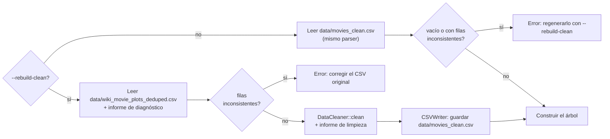

# Preprocesamiento: lectura, diagnóstico, limpieza y normalización

Todo el preprocesamiento está en C++:

| Paso | Código |
|---|---|
| Lectura y diagnóstico del CSV | `src/01_lectura_diagnostico/CSVReaderDiagnostic.h` |
| Limpieza y normalización | `src/02_limpieza_normalizacion/DataCleaner.{h,cpp}` |
| Escritura del CSV limpio | `src/02_limpieza_normalizacion/CSVWriter.{h,cpp}` |
| Orquestación | `main.cpp` |

---

## 1. Datos

- **Fuente:** el dataset [Wikipedia Movie Plots](https://www.kaggle.com/datasets/jrobischon/wikipedia-movie-plots) de Kaggle, archivo `wiki_movie_plots_deduped.csv` (~78 MB, 34 886 películas).
- **Columnas** (las 8 son obligatorias; `CSVReaderDiagnostic.h:114-117`): `Release Year`, `Title`, `Origin/Ethnicity`, `Director`, `Cast`, `Genre`, `Wiki Page`, `Plot`. Se guardan en `RawMovie` (`src/comun/RawMovie.h`), todas como texto.
- **Dónde va cada archivo:**
  - `data/wiki_movie_plots_deduped.csv`: el original. **No está en Git**: hay que descargarlo y colocarlo ahí para usar `--rebuild-clean` (ver el README).
  - `data/movies_clean.csv`: el resultado de la limpieza. **Está en Git**, así que la app arranca sin descargar nada.

## 2. Flujo (`main.cpp:78-124`)



- Sin `--rebuild-clean` se lee el CSV limpio con el mismo parser y se exige que no tenga filas con un número de columnas distinto del encabezado (`main.cpp:82-90`). Si falta el CSV limpio, se intenta regenerarlo desde el original.
- Con `--rebuild-clean`, si falta el original, el programa explica de dónde descargarlo y dónde colocarlo, y termina con código 1 (`main.cpp:95-101`).
- Si el programa se ejecuta desde la carpeta del build, las rutas se buscan también en `../` (`locateDataFile`, `main.cpp:22-26`, y `CSVReaderDiagnostic.h:89-98`).

---

## 3. Parser (`CSVReaderDiagnostic::parseNextRecord`, `CSVReaderDiagnostic.h:28-70`)

El CSV tiene sinopsis con comas, comillas y **saltos de línea dentro de los campos**, así que no se puede leer línea por línea. El parser recorre el archivo **carácter por carácter** (abierto en modo binario) con dos estados: dentro o fuera de comillas.

| Situación | Qué hace |
|---|---|
| `,` fuera de comillas | termina el campo |
| `\n`, `\r` o `\r\n` fuera de comillas | termina el registro (acepta finales de línea de Windows y de Unix) |
| `,` o salto de línea dentro de comillas | forma parte del campo (sinopsis de varios párrafos) |
| `""` dentro de comillas | una comilla literal |
| comilla en medio de un campo sin comillas | **error**: "CSV invalido: comilla dentro de campo sin entrecomillar." |
| texto después de la comilla de cierre | **error**: "CSV invalido: texto despues de comilla de cierre." |
| comillas sin cerrar al final del archivo | **error**: "CSV invalido: comillas sin cerrar." |

Además, `processFile` (`CSVReaderDiagnostic.h:84-187`):

- quita el BOM UTF-8 del encabezado si lo hay (`:107`);
- ubica las columnas **por nombre**, no por posición, y rechaza un encabezado con columnas duplicadas o al que le falte alguna de las 8 (`:108-117`);
- **descarta** (y cuenta) las filas con un número de columnas distinto del encabezado, en vez de desplazar campos (`:140-143`).

---

## 4. Diagnóstico (`DiagnosticReport`, `CSVReaderDiagnostic.h:13-23`)

Mientras lee, cuenta:

| Métrica | Cómo se calcula |
|---|---|
| Total de filas leídas | registros después del encabezado |
| Filas con columnas inconsistentes | número de campos distinto del encabezado (se descartan) |
| Páginas Wiki duplicadas | misma `Wiki Page` vista antes (`:172-175`) |
| Películas duplicadas (Título+Año) | mismo título y año vistos antes (`:177-181`) |
| Bytes no ASCII | bytes mayores que 127: tildes, otros alfabetos o codificación rota; **no implica corrupción** |
| Vacíos por columna | campos que quedan vacíos tras normalizar espacios |
| `'Unknown'` por columna | campos cuyo valor normalizado es `unknown` (`:152-156`) |

Los duplicados **solo se informan, no se eliminan**: la limpieza conserva todos los registros (`tests/DataCleanerTests.cpp:18`, "Conservar duplicados"), y el informe sirve para que el grupo sepa cuántos hay.

Resultado con el CSV original completo (`--rebuild-clean`, ejecutado el 18-11-2026):

```
Total de filas leidas: 34886
Filas con columnas inconsistentes: 0
Paginas Wiki duplicadas: 816
Peliculas duplicadas (Titulo+Ano): 278
Bytes no ASCII (no implica corrupcion): 98693
-------------------------------------------------------
Valores faltantes por columna:
 - Release Year       | Vacios: 0      (0.0 %) | 'Unknown': 0
 - Title              | Vacios: 0      (0.0 %) | 'Unknown': 2
 - Origin/Ethnicity   | Vacios: 0      (0.0 %) | 'Unknown': 0
 - Director           | Vacios: 8      (0.0 %) | 'Unknown': 1124
 - Cast               | Vacios: 1454   (4.2 %) | 'Unknown': 1
 - Genre              | Vacios: 28     (0.1 %) | 'Unknown': 6083
 - Wiki Page          | Vacios: 0      (0.0 %) | 'Unknown': 0
 - Plot               | Vacios: 0      (0.0 %) | 'Unknown': 0
```

---

## 5. Limpieza (`DataCleaner::clean`, `DataCleaner.cpp:89-110`)

Se aplica a los 8 campos de cada película **sin eliminar ni reordenar películas**: el id de cada una (su posición) se mantiene.

### Limpieza de texto (`DataCleaner::cleanText`, `DataCleaner.cpp:18-55`)

| Caso | Acción |
|---|---|
| BOM (`U+FEFF`) y espacio de ancho cero (`U+200B`) | se eliminan (`:26-31`) |
| Espacio no separable (`U+00A0`) | se convierte en espacio (`:32-37`) |
| Caracteres de control (bytes < 32, incluidos `\n`, `\r` y `\t`, y el 127) | se convierten en espacio (`:38-44`) |
| Varios espacios seguidos | quedan en uno |
| Espacios al principio y al final | se eliminan |

Recorre el texto byte a byte, pero reconoce esas secuencias UTF-8 completas: **no rompe tildes ni otros alfabetos**. No cambia mayúsculas ni puntuación: el texto que se muestra al usuario conserva su forma original (`tests/DataCleanerTests.cpp:24`, "Conservar puntuacion y acentos").

### Marcadores de dato faltante (`DataCleaner::isMissingMarker`, `DataCleaner.cpp:83-87`)

- En **Director, Reparto y Género**, el valor `Unknown` (sin distinguir mayúsculas) se convierte en vacío, igual que `-` en Género.
- En el **Título** no: "Unknown" puede ser un título real (`tests/DataCleanerTests.cpp:22`).
- No se tocan el año (se conservan ceros iniciales), la URL ni la sinopsis.

Así, la interfaz muestra "No registrado" en lugar de "Unknown", y el recomendador no considera "del mismo director" a dos películas con director desconocido.

### Informe de limpieza (`DataCleaner::printReport`, `DataCleaner.cpp:112-131`)

Cuenta los registros procesados (todos se conservan), los campos modificados, los espacios sobrantes eliminados, los espacios no separables y los caracteres de control reemplazados, los caracteres invisibles eliminados, y por columna los vacíos y los marcadores convertidos a vacío.

Resultado con el CSV original completo:

```
Registros procesados (todos conservados): 34886
Campos modificados: 33123
Espacios sobrantes eliminados: 100584
Espacios no separables reemplazados: 1504
Caracteres de control reemplazados: 198554
Caracteres invisibles eliminados: 6
 - Release Year | Vacios: 0 | Marcadores faltantes: 0
 - Title | Vacios: 0 | Marcadores faltantes: 0
 - Origin/Ethnicity | Vacios: 0 | Marcadores faltantes: 0
 - Director | Vacios: 8 | Marcadores faltantes: 1124
 - Cast | Vacios: 1454 | Marcadores faltantes: 1
 - Genre | Vacios: 28 | Marcadores faltantes: 6086
 - Wiki Page | Vacios: 0 | Marcadores faltantes: 0
 - Plot | Vacios: 0 | Marcadores faltantes: 0
Total de campos vacios detectados: 1490
Total de marcadores convertidos a vacio: 7211
Total de campos faltantes finales: 8701
```

Lectura de las cifras:

- Los 2 títulos "Unknown" se conservan: en el título no se toma como dato faltante.
- En Género hay 6 086 marcadores convertidos a vacío y 6 083 "Unknown" en el diagnóstico; la diferencia (3) son géneros `-`.
- Los 198 554 caracteres de control son los saltos de línea (`\r\n`) que hay **dentro** de los campos entre comillas: 193 774 en sinopsis y 4 780 en reparto (contados aparte, con Python, sobre el CSV original). Pasan a ser espacios.

La limpieza es **idempotente**: limpiar un CSV ya limpio no modifica nada (`tests/DataCleanerTests.cpp:29`). Por eso, regenerar `data/movies_clean.csv` desde el original produce el mismo archivo, byte a byte, que el versionado en Git (comprobado en un clon limpio).

---

## 6. Escritura del CSV limpio (`CSVWriter::writeFile`, `CSVWriter.cpp:18-46`)

- Escribe el encabezado y **todos los campos entre comillas**, duplicando las comillas internas, con fin de línea `\r\n`.
- Escribe primero en `movies_clean.csv.tmp` y lo renombra al final: si la escritura falla, no queda un CSV a medias (`:20-40`).

---

## 7. Normalización para buscar (`DataCleaner::normalizeForSearch`, `DataCleaner.cpp:78-81`)

Es la función que usan **el árbol, las búsquedas, el recomendador y el diagnóstico**, tanto para los textos de las películas como para la consulta del usuario. Por eso los dos lados siempre se comparan igual.

1. `cleanText`: los mismos espacios y controles que la limpieza.
2. `lowercaseText` (`DataCleaner.cpp:57-76`):
   - `A`–`Z` → `a`–`z`;
   - letras latinas mayúsculas en UTF-8 (pares que empiezan con el byte `0xC3`: `À Á Â Ã Ä Å Æ Ç È É Ê Ë Ì Í Î Ï Ð Ñ Ò Ó Ô Õ Ö Ø Ù Ú Û Ü Ý Þ`) → su minúscula;
   - no depende de la configuración regional del sistema y nunca parte un carácter UTF-8.

**Qué no hace** (decisión de diseño, ver [arbol.md](arbol.md#6-limitaciones)): no quita tildes (`café` ≠ `cafe`), no quita signos de puntuación (`x-ray` es una sola palabra) y no pasa a minúsculas otros alfabetos (griego, cirílico, CJK quedan igual). El texto se compara como subcadena, así que "ghost," en una sinopsis igual coincide con la consulta "ghost".

---

## 8. Pruebas

- `csv_reader_tests` (`tests/CSVReaderTests.cpp`): comillas, campos de varias líneas y BOM; duplicados; vacíos y "Unknown"; ida y vuelta escribir → leer → limpiar; rechazo de columnas faltantes, comillas sin cerrar, comillas dentro de campos sin comillas y texto después de la comilla de cierre; filas mal formadas descartadas.
- `data_cleaner_tests` (`tests/DataCleanerTests.cpp`): conserva duplicados, ceros iniciales, URL, puntuación y acentos; "Unknown" como título válido; marcadores faltantes; conteo de controles; idempotencia; minúsculas de letras acentuadas y otros alfabetos intactos; vector vacío.
- `csv_writer_tests` (`tests/CSVWriterTests.cpp`): el contenido exacto del archivo (comillas duplicadas, comas y saltos de línea dentro de campos, `\r\n`), el reemplazo de un archivo existente sin dejar el `.tmp` y el error al escribir en una carpeta inexistente.
