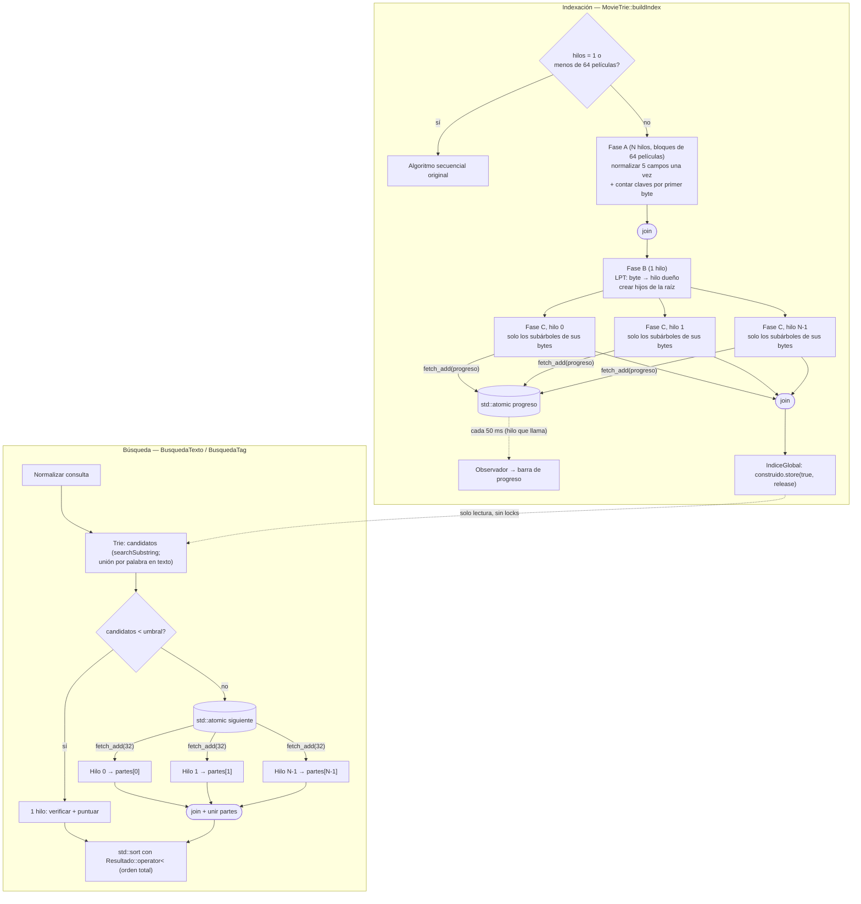

# Programación paralela — Parte 2

Plataforma de streaming de películas (C++20, CMake). Se paralelizó la **construcción del índice** (inserción en el Trie) y la **búsqueda** (verificación y puntaje de candidatos), usando solo la biblioteca estándar: `std::thread`, `std::atomic`, `std::mutex`, `std::condition_variable` y `std::call_once`.

El paralelismo no cambia los resultados: con cualquier número de hilos las búsquedas devuelven las mismas películas, con los mismos puntajes y en el mismo orden ([Cómo se verificó](#7-cómo-se-verificó)).

**Resumen.** Mediciones del 18-11-2026 en un **AMD Ryzen 3 3200G (4 hilos)**, catálogo completo (34 886 películas), comparadas con la versión sin paralelismo (commit `55a2ddc`). Mediana de cada medición; el detalle está en la [sección 5](#5-resultados).

| Qué | Sin paralelismo (`55a2ddc`) | Actual, 4 hilos | Mediciones |
|---|---|---|---|
| Construir el índice | 34,9 s | 7,4 s (**4,71×**) | 5, intercaladas |
| Búsqueda frecuente `"the"` | 2 045 ms | 345 ms (**5,93×**) | **6**, intercaladas |
| Sesión completa de la app (11 consultas) | 47,5 s | 17,4 s (**2,74×**) | 3 rondas intercaladas |

En otro equipo, un Intel Core 5 210H con 12 hilos, la indexación pasó de 44,1 s a 4,0 s (11,0×). La indexación no cambió desde entonces, así que esa medición sigue siendo válida ([Tabla 1b](#tabla-1b--indexación-intel-core-5-210h-12-hilos-medición-anterior)).

---

## 1. Qué se paralelizó y por qué

### Indexación

| Dato | Valor | Equipo |
|---|---|---|
| Claves insertadas (una por carácter normalizado) | 78 392 326 | dato del catálogo |
| Tiempo de `MovieTrie::buildIndex` sin paralelismo | 34,9 s | Ryzen 3 3200G |
| Pico de memoria del proceso | 1 821 MB | Ryzen 3 3200G |
| Parte del tiempo que es solo normalizar texto | 3,7 % | Core 5 210H (medición anterior al paralelismo) |

Casi todo el tiempo es **insertar claves** en el Trie: bajar hasta 3 niveles y agregar el id a un `unordered_set` en cada nivel (ver [arbol.md](arbol.md)). Es el mayor costo del programa y ocurre en cada arranque.

### Búsqueda

Perfil por fases de la búsqueda por texto sin normalización única (`benchmark --modo perfil --reps 3`, Ryzen 3 3200G, 1 hilo, promedio en ms):

| Consulta | Normalizar consulta | Recorrido del Trie | Verificación | Puntaje | `std::sort` |
|---|---|---|---|---|---|
| `"the"` | 0,00 | 9,06 | 852 | 1 223 | 11,1 |
| `"love"` | 0,00 | 4,50 | 557 | 589 | 4,30 |
| `"ar"` | 0,00 | 9,21 | 980 | 1 217 | 10,6 |
| `"a"` | 0,00 | 9,08 | 325 | 1 214 | 11,4 |

Más del 98 % del tiempo se va en **verificar y puntuar candidatos**, y **cada candidato es independiente** y de solo lectura: es el caso ideal para repartir en hilos. El recorrido del Trie y el ordenamiento (menos del 2 %) quedan secuenciales.

El perfil mostró además que cada candidato normalizaba sus 5 campos **dos veces** (una para verificar y otra para puntuar) y el título una tercera. Se agregó una **normalización única**, con la misma lógica y los mismos puntajes, y se midió aparte de los hilos: es la columna "1 hilo" de la Tabla 2.

**Decisión:** paralelizar ambas. La búsqueda tiene una fracción paralelizable cercana al 98 %; la indexación es el costo más grande y cada subárbol del Trie se puede construir por separado.

---

## 2. Estrategia de sincronización

### 2.1 Indexación: partición por primer carácter

Toda clave que empieza con el carácter `c` vive en el subárbol `root->children[c]`. Si cada carácter tiene **un único hilo dueño**, los subárboles son disjuntos y ningún nodo es escrito por dos hilos: **no hacen falta locks ni fusión**.

`MovieTrie::buildIndex(movies, hilos, observador)` (`src/03_arbol_insercion/MovieTrie(arbol).cpp:90-102`, `buildParalelo` en `:161-232`):

| Fase | Quién | Qué hace |
|---|---|---|
| A | N hilos, bloques dinámicos de 64 películas | Normaliza los 5 campos de cada película **una vez** y cuenta cuántas claves empiezan con cada byte (el peso de cada subárbol). |
| B | Un hilo | Reparte los bytes entre los hilos con **LPT** (el más pesado primero, al hilo con menos carga) y crea los hijos de la raíz. Desde aquí `root->children` no cambia. |
| C | N hilos, uno por partición | Cada hilo recorre todas las películas en orden de id e inserta solo las claves cuyo primer byte le pertenece. |

Por qué LPT: los caracteres no pesan lo mismo. En el catálogo completo hay 165 primeros bytes distintos; el espacio es el 16,9 % de las claves, la `e` el 9,5 % y la `a` el 7,3 %. Repartir por orden alfabético dejaría a un hilo con mucho más trabajo que a los demás.

| Dato compartido | Quién escribe | Quién lee |
|---|---|---|
| `movies` | nadie | todos |
| `textos[id]` (fase A) | solo el hilo que tomó ese bloque | todos en la fase C (después del `join`) |
| `pesosPorHilo[h]` | solo el hilo `h` | el hilo que llama, después del `join` |
| `root->children` | el hilo que llama (fase B) | todos en la fase C (solo lectura) |
| subárbol del byte `c` | solo `duenio[c]` | nadie durante la construcción |
| `progreso` (`std::atomic<size_t>`) | todos (`fetch_add`, relaxed) | el hilo que llama (observador) |

Cada hilo inserta los ids en orden creciente, igual que el algoritmo secuencial, por eso cada nodo termina con exactamente el mismo conjunto de ids. `MovieTrie::mismoContenido` lo verifica nodo por nodo.

Con `hilos = 1`, o con menos de 64 películas, se usa el algoritmo secuencial original.

### 2.2 Búsqueda: bloques de candidatos

`procesarCandidatos` (`src/04_busqueda/Busqueda.cpp:23-61`):

1. El Trie devuelve los candidatos (secuencial). En la búsqueda por texto "y/o" son la unión de los candidatos de cada palabra (ver [algoritmos.md](algoritmos.md)).
2. Si hay menos candidatos que el **umbral**, todo se hace en un hilo.
3. Si no, se copian a un vector y cada hilo toma **bloques de 32** de un contador `std::atomic<size_t>` (`fetch_add`). Cada hilo verifica, puntúa y guarda en **su propio** `std::vector<Resultado>`.
4. Después del `join` se unen los vectores y se ordena con `std::sort` y `Resultado::operator<`.

`Resultado::operator<` es un **orden total** (prioridad, luego título, luego id), así que el resultado final no depende de qué hilo procesó cada candidato ni del orden en que se unieron las partes.

El reparto es dinámico, no por bloques fijos, porque las sinopsis tienen largos muy distintos: con bloques fijos, el hilo que recibe sinopsis largas terminaría último y los demás lo esperarían. En procesadores con núcleos de distinta velocidad (como el Core 5 210H, con P-cores y E-cores) esto importa todavía más.

### 2.3 Singleton: `call_once` + release/acquire

`IndiceGlobal::construir` ejecuta la indexación paralela dentro de `std::call_once`. Todos los hilos de la indexación se unen (`join`) antes de que `construir` haga `construido.store(true, std::memory_order_release)`. `estaConstruido()` hace `load(std::memory_order_acquire)`: quien ve el índice construido ve también todo el árbol escrito por los hilos.

Después de construir, el índice es de **solo lectura** (`arbol()` y `peliculas()` devuelven referencias `const`), por eso varias búsquedas paralelas pueden leerlo **sin locks**. Cada hilo de búsqueda escribe solo en su propio vector de resultados.

### 2.4 Observer de progreso: contador atómico y un solo hilo que notifica

`IObservadorIndexacion` (`src/03_arbol_insercion/ObservadorIndexacion.h`):

- Los hilos trabajadores **no** llaman al observador: solo hacen `progreso.fetch_add(insertadas, relaxed)` al terminar cada película.
- El hilo que llamó a `buildIndex` no inserta: espera con `condition_variable::wait_for(50 ms)` y en cada vuelta notifica `onProgresoIndexacion(progreso, total)`. Nunca hay llamadas concurrentes al observador.
- La última notificación siempre es `(total, total)`.

En la interfaz, `BarraProgreso` solo guarda el avance en dos atómicos (no imprime ni bloquea la indexación), y el hilo principal dibuja 20 `#` proporcionales al avance real (ver [patrones_diseno.md](patrones_diseno.md), sección 4.2).

---

## 3. Diagrama del flujo



---

## 4. Configuración

| Dónde | Parámetro | Valor por defecto |
|---|---|---|
| `main` | `--hilos N` | `std::thread::hardware_concurrency()` (4 en el Ryzen 3 3200G, 12 en el Core 5 210H) |
| `MovieTrie::buildIndex(movies, hilos, observador)` | `hilos` | `0` = el valor de `--hilos` o `hardware_concurrency` |
| `BusquedaTexto(hilos, umbral)` | `umbral` | 32 candidatos |
| `BusquedaTag(campo, hilos, umbral)` | `umbral` | 512 candidatos |
| `MovieTrie::MIN_PELICULAS_PARALELO` | — | 64 películas |

Con `hilos = 1` se usan exactamente los algoritmos secuenciales.

---

## 5. Resultados

### 5.1 Condiciones y protocolo

Las condiciones se registraron **sin cambiar ningún ajuste del sistema**.

| Condición | Ryzen 3 3200G (mediciones actuales) |
|---|---|
| Procesador | AMD Ryzen 3 3200G: 4 núcleos, 1 hilo por núcleo (sin SMT); `nproc` = `hardware_concurrency()` = 4; frecuencia 1,4–3,6 GHz, boost activo |
| Memoria / SO / compilador | 16 GB, Linux 7.2.8, GCC 16.2.1, `-O3 -DNDEBUG` (las dos versiones con las mismas banderas) |
| Alimentación | equipo de escritorio, **en corriente** (no hay batería: `/sys/class/power_supply` está vacío) |
| `powerprofilesctl` / `platform_profile` | `balanced` / no disponible |
| `scaling_governor` (driver) | `schedutil` en los 4 núcleos (`acpi-cpufreq`); sin `energy_performance_preference` |
| Carga de fondo | sesión gráfica abierta; carga media de 1,0–1,9 justo antes de medir |
| Frecuencia promedio durante las mediciones | 2,2–3,0 GHz (`scaling_cur_freq`, promedio de los 4 núcleos, muestreado cada 0,5 s) |

**Base** = el código real del commit `55a2ddc`, el último sin paralelismo: `bench/BenchRonda.cpp` se compila contra esa versión y contra la actual con las mismas banderas (`bench/comparar_versiones.sh`). Cada medición es un **proceso nuevo**, y las configuraciones (base, 1, 2 y 4 hilos) se **intercalan**: en cada ronda se ejecuta una vez cada una, rotando el orden.

| Medición | Repeticiones usadas | Calentamiento |
|---|---|---|
| Indexación, catálogo completo | **5** (rondas 0–4) | ninguno |
| Búsqueda, catálogo completo | **6** (rondas 1–6) | ronda 0 descartada, y cada consulta se ejecuta una vez sin medir dentro de cada proceso |
| Sesión completa de la app | **3 rondas** intercaladas (base/actual, alternando el orden) | ninguno |

La búsqueda se planificó con 9 repeticiones, pero se cortó después de la ronda 6 para acortar la medición: **son 6 repeticiones, no 9**. La ronda 7, incompleta, no se usó.

Cada celda muestra **mediana (mín–máx, ±rango relativo)**, con rango relativo = (máx − mín) / mediana. **⚠ = poco fiable**: el rango supera el 25 % de la mediana. El **speedup** es la razón entre medianas medidas en las mismas condiciones; entre paréntesis va el intervalo pesimista–optimista, mín(base)/máx(config) – máx(base)/mín(config).

No se repitió la medición con `--limite 1000` en el Ryzen.

### Tabla 1 — Indexación (Ryzen 3 3200G, 4 hilos)

`MovieTrie::buildIndex` con el catálogo completo, 5 repeticiones. VmHWM = pico de memoria del proceso (incluye el CSV cargado).

| Config | Tiempo ms | Speedup vs base | VmHWM MB | Frecuencia prom. MHz |
|---|---|---|---|---|
| base (`55a2ddc`) | 34 952 (34 711–36 298, ±5 %) | 1,00× | 1 821 | 2 232 |
| 1 hilo | 35 774 (34 849–36 568, ±5 %) | 0,98× (0,95–1,04) | 1 822 | 2 264 |
| 2 hilos | 13 825 (13 726–15 241, ±11 %) | **2,53×** (2,28–2,64) | 1 903 | 2 623 |
| 4 hilos | 7 413 (7 283–7 632, ±5 %) | **4,71×** (4,55–4,98) | 1 902 | 2 966 |

Con 1 hilo se usa el algoritmo secuencial original: base y 1 hilo hacen lo mismo, y la diferencia (0,98×) está dentro de la variación.

### Tabla 1b — Indexación, Intel Core 5 210H (12 hilos), medición anterior

Medida antes de esta revisión, en otro equipo: Core 5 210H, 4 P-cores con hyperthreading y 4 E-cores (12 hilos de hardware), 23 GB, GCC 16.2, **con batería**, perfil `balanced`, governor `powersave` y `energy_performance_preference = balance_power`; frecuencia promedio de 1,1–1,3 GHz, con bajadas hasta ~570 MHz. El código de indexación es el mismo que el actual (el cambio a K = 8 se revirtió), así que estas cifras siguen siendo válidas **para ese equipo**. **No se comparan con las del Ryzen**: el equipo y las condiciones son otros.

**Catálogo completo, 5 repeticiones**

| Config | Tiempo ms | Speedup | VmHWM MB |
|---|---|---|---|
| base (`55a2ddc`) | 44 054 (39 581–45 243, ±13 %) | 1,00× | 1 821 |
| 1 hilo | 41 546 (39 384–43 768, ±11 %) | 1,06× (0,90–1,15) | 1 821 |
| 2 hilos | 15 897 (15 600–17 378, ±11 %) | **2,77×** (2,28–2,90) | 1 902 |
| 4 hilos | 8 143 (7 864–8 733, ±11 %) | **5,41×** (4,53–5,75) | 1 902 |
| 12 hilos | 3 992 (3 847–4 094, ±6 %) | **11,04×** (9,67–11,76) | 1 903 |

**`--limite 1000`, 9 repeticiones**

| Config | Tiempo ms | Speedup | VmHWM MB |
|---|---|---|---|
| base | 441 (431–671, ±54 %) ⚠ | 1,00× | 101 |
| 1 hilo | 446 (439–805, ±82 %) ⚠ | 0,99× (0,53–1,53) | 101 |
| 2 hilos | 202 (194–286, ±46 %) ⚠ | 2,19× (1,50–3,45) | 122 |
| 4 hilos | 113 (99–190, ±81 %) ⚠ | 3,89× (2,27–6,77) | 132 |
| 12 hilos | 71 (51–108, ±79 %) ⚠ | 6,19× (4,00–13,05) | 137 |

### Tabla 2 — Búsqueda (Ryzen 3 3200G, 4 hilos)

Catálogo completo, **6 repeticiones intercaladas**, ms.

- **base** = `55a2ddc` (sin paralelismo y sin normalización única).
- **1 hilo** = código actual con 1 hilo (solo la normalización única).
- **2 / 4 hilos** = normalización única + hilos.

| Consulta | Resultados (actual) | base | 1 hilo | 2 hilos | 4 hilos | 4 hilos vs base | 4 hilos vs 1 hilo |
|---|---|---|---|---|---|---|---|
| texto `"the"` | 34 522 | 2 045 (2 002–2 059, ±3 %) | 1 195 (1 185–1 206, ±2 %) | 635 (627–643, ±3 %) | 345 (338–352, ±4 %) | **5,93×** (5,70–6,09) | 3,46× |
| texto `"love"` | 14 290 | 1 134 (1 111–1 143, ±3 %) | 606 (600–612, ±2 %) | 325 (314–334, ±6 %) | 165 (164–176, ±7 %) | **6,87×** (6,31–6,97) | 3,67× |
| texto `"ar"` | 34 430 | 2 173 (2 133–2 187, ±2 %) | 1 195 (1 186–1 209, ±2 %) | 641 (625–646, ±3 %) | 342 (335–385, ±15 %) | **6,35×** (5,54–6,53) | 3,49× |
| texto `"a"` | 34 886 | 1 513 (1 490–1 536, ±3 %) | 1 185 (1 173–1 209, ±3 %) | 632 (618–635, ±3 %) | 339 (336–343, ±2 %) | **4,46×** (4,35–4,57) | 3,50× |
| texto `"ghost ship"` † | 9 145 | 113 (113–114, ±2 %) † | 780 (769–786, ±2 %) | 404 (401–408, ±2 %) | 213 (208–234, ±12 %) | no comparable † | 3,66× |
| texto `"the ship"` † | 34 537 | 1 269 (1 260–1 277, ±1 %) † | 1 393 (1 376–1 410, ±2 %) | 738 (732–747, ±2 %) | 394 (383–401, ±5 %) | no comparable † | 3,54× |
| director `"spielberg"` | 31 | 7,20 (7,14–7,52, ±5 %) | 7,18 (7,05–7,29, ±3 %) | 6,56 (6,15–7,14, ±15 %) | 5,14 (4,95–6,78, ±36 %) ⚠ | 1,40× (1,05–1,52) | 1,40× |
| reparto `"john"` | 2 161 | 11,4 (11,3–11,7, ±4 %) | 9,14 (9,09–9,33, ±3 %) | 7,84 (6,39–7,91, ±19 %) | 4,71 (4,58–5,09, ±11 %) | 2,42× (2,22–2,56) | 1,94× |
| género `"drama"` | 9 475 | 14,4 (14,3–14,7, ±3 %) | 12,8 (12,7–13,0, ±3 %) | 12,9 (11,4–13,3, ±14 %) | 9,45 (9,29–11,3, ±21 %) | 1,53× (1,27–1,59) | 1,35× |

† **Frases:** la base busca la frase contigua (`"ghost ship"` devuelve 4 películas; `"the ship"`, 991) y la versión actual busca "y/o" (9 145 y 34 537), así que hace otro trabajo y el speedup contra la base no tiene sentido. Para las frases solo vale la comparación entre 1, 2 y 4 hilos de la versión actual.

**Resultados idénticos:** en las 7 consultas de una palabra o tag, el orden de los ids devueltos fue el mismo que el de la base en todas las rondas y configuraciones (`chk` de `BenchRonda`). En las dos frases difiere, a propósito, por el "y/o".

Descomposición en las consultas frecuentes: la normalización única da entre 1,3× y 1,9× (por ejemplo, `"the"`: 2 045 → 1 195 ms), y los 4 hilos multiplican por ~3,5× más (1 195 → 345 ms).

### Tabla 3 — Sesión completa de la app (Ryzen 3 3200G, 4 hilos)

Catálogo completo, guion `bench/sesion_entrada.txt` (11 consultas con paginación y detalle). Tiempo de reloj desde que arranca la app hasta que sale; incluye leer el CSV (~2,1 s) y construir el índice. 3 rondas intercaladas.

| Versión | Sesión completa | Speedup |
|---|---|---|
| base (`55a2ddc`) | 47,5 s (47,3–48,4, ±2 %) | 1,00× |
| actual (4 hilos) | 17,4 s (17,0–17,5, ±3 %) | **2,74×** (2,70–2,85) |

La salida fue **idéntica en las 3 rondas**. El guion solo usa palabras, sub-palabras y tags, cuyo resultado no cambió; el filtro de comparación ignora los tiempos, la barra de progreso y el texto de ayuda de la pantalla de búsqueda, que cambió con el "y/o" (ver el comentario en `bench/comparar_versiones.sh`).

La sesión mejora menos que la indexación o la búsqueda porque incluye partes secuenciales: leer el CSV, la interfaz y las consultas por tag, que casi no aceleran.

### ¿La diferencia supera la variación?

Sí en las mediciones principales: los intervalos mín–máx **no se solapan**.

- Indexación: el mínimo de la base (34 711 ms) es más del doble del máximo con 2 hilos (15 241 ms), y este casi el doble del máximo con 4 hilos (7 632 ms).
- `"the"`: base 2 002–2 059 ms, 1 hilo 1 185–1 206, 2 hilos 627–643, 4 hilos 338–352. Lo mismo en `"love"`, `"ar"`, `"a"` y, entre 1, 2 y 4 hilos, en las dos frases.
- Sesión: base 47,3–48,4 s contra 17,0–17,5 s.

**No** en las búsquedas por tag `"spielberg"` y `"drama"` entre 1 y 2 hilos: sus intervalos se solapan y esas diferencias no son concluyentes.

### 5.2 Speedup observado frente a la ley de Amdahl (4 hilos)

Amdahl: S(N) = 1 / (s + (1 − s) / N), con s = fracción secuencial.

**Búsqueda.** Se compara contra la versión actual con 1 hilo (normalización única), porque los hilos se aplican sobre ella. La parte secuencial medida es el recorrido del Trie más el `std::sort`, según el perfil de la sección 1 (Ryzen); por ejemplo, para `"the"`: s = (9,06 + 11,13) / 1 195 ≈ 1,7 %.

| Consulta | s | Amdahl 2 hilos | Observado 2 hilos | Amdahl 4 hilos | Observado 4 hilos | Eficiencia con 4 hilos |
|---|---|---|---|---|---|---|
| `"the"` | 1,7 % | 1,97× | 1,88× | 3,81× | 3,46× | 87 % |
| `"love"` | 1,5 % | 1,97× | 1,86× | 3,83× | 3,67× | 92 % |
| `"ar"` | 1,7 % | 1,97× | 1,86× | 3,81× | 3,49× | 87 % |
| `"a"` | 1,7 % | 1,97× | 1,88× | 3,80× | 3,50× | 87 % |

El observado queda entre un 4 % y un 9 % por debajo del teórico. **Esto no se midió en detalle**; son las partes secuenciales y los costos que el perfil no cuenta:

1. **Trabajo secuencial fuera del perfil:** copiar el conjunto de candidatos a un vector, crear y unir los hilos en cada búsqueda y unir los vectores de resultados. El s de la tabla solo incluye el Trie y el `sort`, así que el s real es algo mayor.
2. **Recursos compartidos:** cada candidato crea 5 strings normalizados (memoria dinámica) y lee su sinopsis; los 4 hilos comparten el asignador de memoria y el ancho de banda.
3. **Fin desparejo:** el último bloque de 32 candidatos que toma cada hilo no termina al mismo tiempo.

**Indexación.** En el algoritmo particionado la única parte secuencial es la fase B y la creación de los hilos, así que Amdahl permite como máximo ~4× con 4 hilos. La partición más pesada (el espacio, 16,9 % de las claves) no limita con 4 hilos: su límite sería 1 / 0,169 ≈ 5,9×. Sin embargo, se observó **4,71× contra la base** y **4,83× contra 1 hilo**, es decir, por encima de 4×: un speedup **superlineal**.

**La causa no se midió en este equipo**, así que no se atribuye a la caché. Hay dos datos que deben tenerse en cuenta, pero ninguno la explica por sí solo:

- **El algoritmo con 1 hilo no es el mismo que con 2 o 4.** Con 1 hilo se usa `insertKey` (secuencial original), y con varios hilos, `insertarDesde`, que hace una sola búsqueda en el mapa de hijos por nivel y no crea `substr` (`MovieTrie(arbol).cpp:18-27` contra `:54-67`). En el Core 5 210H, el algoritmo particionado forzado a 1 hilo fue 1,23× más rápido que el secuencial (experimento anterior, no incluido en el repositorio). **No se repitió en el Ryzen.**
- **La frecuencia promedio muestreada fue mayor con más hilos** (2 264 MHz con 1 hilo y 2 966 MHz con 4). Pero es el promedio de los 4 núcleos, incluidos los que están inactivos con 1 hilo, así que **no** demuestra que el núcleo ocupado fuera más lento con 1 hilo.

---

## 6. Limitaciones

1. **Condiciones de medición.** Equipo de escritorio en corriente, governor `schedutil` con boost y perfil `balanced`, sin cambiar ajustes y con una sesión gráfica abierta (carga media de 1,0–1,9 antes de medir). Variación observada (rango relativo a la mediana):
   - indexación: ±5 % a ±11 %;
   - búsquedas de texto: ±1 % a ±15 %;
   - búsquedas por tag (pocos milisegundos): hasta ±36 % (⚠ en `"spielberg"` con 4 hilos).

   Los **tiempos absolutos** dependen del equipo y de las condiciones. El **speedup** se informa solo como razón entre mediciones intercaladas en las mismas condiciones, y también cambia con el equipo (Tabla 1b).
2. **Repeticiones limitadas:** 5 en la indexación, **6** en la búsqueda (se cortó la medición planificada de 9) y 3 rondas en la sesión. Con tan pocas muestras la mediana es razonable, pero el rango puede subestimar la variación real.
3. **Ley de Amdahl.** La búsqueda frecuente rinde un 87–92 % de lo ideal con 4 hilos (sección 5.2). Con más hilos que `hardware_concurrency()` no se midió en el Ryzen; los hilos extra comparten los mismos núcleos (ver la pregunta 3 de la guía).
4. **El último tramo de la indexación es el más lento.** LPT reparte el *número de claves*, no el costo real, y una partición (la del espacio, 16,9 % de las claves) no se puede dividir: el hilo que la tiene puede terminar último. Con 4 hilos ese límite (5,9×) no se alcanza, pero con muchos hilos sí (Core 5 210H, 12 hilos).
5. **Memoria temporal.** La fase A guarda los textos normalizados de todas las películas: el pico sube de 1 821–1 822 MB (base y 1 hilo) a 1 902–1 903 MB (2 y 4 hilos), unos +81 MB. Se liberan al terminar, pero el asignador puede no devolverlos al sistema.
6. **Las búsquedas por tag ganan poco.** Verificar un candidato por tag cuesta muy poco (se normaliza un solo campo corto), así que pesan más las partes secuenciales: copiar el conjunto de candidatos, crear los hilos, unir los resultados y ordenar. Con el catálogo completo bajan de 7–14 ms a 5–9 ms.
7. **Umbrales.** Por debajo de 32 candidatos (texto), 512 candidatos (tag) o 64 películas (indexación) se usa un solo hilo, porque crear hilos cuesta más de lo que se ahorra. Los valores salen de un barrido en el Core 5 210H (`benchmark --modo umbral`); en el Ryzen no se repitió y el punto de cruce puede ser distinto.
8. **Normalización única.** Ayuda poco cuando casi todos los candidatos se descartan, porque esos ya se normalizaban una sola vez.
9. **Frases con palabras frecuentes.** Con el "y/o", `"the ship"` revisa casi todo el catálogo (34 537 resultados, 394 ms con 4 hilos): cuesta como una búsqueda de `"the"`.

---

## 7. Cómo se verificó

1. **Salida idéntica de la app** (Tabla 3). `bench/sesion_entrada.txt` ejecuta 11 consultas con paginación (siguiente, siguiente, anterior, abrir el detalle y volver): palabras (`ghost`, `love`, `war`), sub-palabra (`ar`), muy frecuente (`the`), sin resultados (`zxqv`), director (`griffith`), reparto (`chaplin`), género (`drama`, `comedy`) y un tag sin resultados. La salida de la versión actual (4 hilos) fue idéntica a la de `55a2ddc` en las 3 rondas, ignorando tiempos, la barra de progreso y el texto de ayuda de la búsqueda.
2. **Pruebas** (`tests/ParaleloTests.cpp`, `ctest`):
   - el índice paralelo es igual al secuencial nodo por nodo con 1, 2, 4, 2×núcleos+3 y hilos automáticos, también al reconstruir;
   - la búsqueda de texto (incluidas frases "y/o") y por tag con varios hilos devuelve lo mismo (ids, puntajes y orden) que la secuencial y que una implementación de referencia, con umbral por defecto y con umbral 0;
   - el observador recibe todas las notificaciones desde el hilo que llama, con avance monótono, total constante y final `total/total`;
   - casos con 0, 1 y 3 películas, y con 64 películas y 300 hilos.
3. **Mediciones:** `bench/comparar_versiones.sh` guarda en cada ronda un hash del orden de los ids de cada consulta (`chk`), y `bench/resumir.py` comprueba que sea igual al de la base (Tabla 2).
4. **ThreadSanitizer** (`-fsanitize=thread`, build aparte): en la versión anterior a esta revisión dio **0 data races** en las pruebas de `ctest` y en la app con `--limite 1000` y `--hilos 1`, `2` y `12`. Se repite con el código final en la verificación de cierre.

---

## 8. Cómo reproducir

```sh
cmake -S . -B cmake-build-release -DCMAKE_BUILD_TYPE=Release
cmake --build cmake-build-release -j
ctest --test-dir cmake-build-release --output-on-failure

# Comparación intercalada contra 55a2ddc (base por defecto del script)
bench/comparar_versiones.sh motor --hilos "1 2 4" --rondas 9 --salida motor.csv
bench/comparar_versiones.sh sesion --rondas 3 --salida sesion.csv
python3 bench/resumir.py motor.csv --rondas 0-4    # indexación (sin calentamiento)
python3 bench/resumir.py motor.csv --rondas 1-6    # búsqueda (así se resumieron las 6 repeticiones de la Tabla 2)
python3 bench/resumir.py sesion.csv --rondas 0-2

# Perfil por fases, barrido de umbrales y verificación del árbol
./cmake-build-release/benchmark --modo perfil --reps 3
./cmake-build-release/benchmark --modo umbral
./cmake-build-release/benchmark --modo indice --verificar
```

Las Tablas 1 y 2 salen de una corrida del modo `motor` planificada con 9 rondas y cortada después de la ronda 6, por tiempo.

---

## 9. Guía de exposición

### Archivos, en este orden

| # | Archivo | Qué mostrar |
|---|---|---|
| 1 | Este documento, sección 1 | El perfil: más del 98 % de la búsqueda es verificar y puntuar; indexar sin paralelismo tarda ~35 s. |
| 2 | `src/03_arbol_insercion/MovieTrie(arbol).cpp` → `buildParalelo` | El comentario de "datos compartidos" y las fases A, B y C. |
| 3 | Mismo archivo → `repartirLPT` y `construirParticion` | Cómo se asigna cada byte a un hilo y la línea `if (duenio[b] != h) continue;`. |
| 4 | `src/comun/Paralelismo.h` → `ejecutarEnHilos` | Creación de hilos, `join` de todos y propagación de excepciones con `std::exception_ptr`. |
| 5 | `src/04_busqueda/Busqueda.cpp` → `procesarCandidatos` | Bloques con `fetch_add`, un vector por hilo, unión y `std::sort`. |
| 6 | `src/03_arbol_insercion/IndiceGlobal.h` | `call_once` + release/acquire: por qué se puede leer sin locks. |
| 7 | `src/03_arbol_insercion/ObservadorIndexacion.h` e `Interfaz::construirIndice` | Contador atómico y notificación desde un solo hilo; la barra en vivo. |
| 8 | `tests/ParaleloTests.cpp` | `mismoContenido` y la comparación de resultados. |
| 9 | Sección 5 | Tablas y speedups, indicando equipo y número de hilos. |

**Demostración en vivo:** `./cmake-build-release/proyecto_progra3_1 --hilos 1` y luego sin `--hilos` (4 hilos en el Ryzen 3 3200G) sobre el catálogo completo, para ver la barra y el tiempo de la etapa `[3/3]`: ~36 s contra ~7 s en ese equipo.

### Fragmentos clave

Cómo se reparte el trabajo de la indexación (cada hilo solo toca sus subárboles):

```cpp
auto construirParticion = [&](size_t h) {
    for (size_t id = 0; id < n; ++id) {
        size_t insertadas = 0;
        for (const std::string& texto : textos[id]) {
            for (size_t i = 0; i < texto.size(); ++i) {
                const size_t b = byteDe(texto[i]);
                if (duenio[b] != h) continue;          // no es de este hilo
                insertarDesde(tablaRaiz[b], texto, i, KEY_SIZE, id);
                ++insertadas;
            }
        }
        if (insertadas > 0) progreso.fetch_add(insertadas, std::memory_order_relaxed);
    }
};
```

Cómo se reparte y se une el trabajo de la búsqueda:

```cpp
paralelo::ejecutarEnHilos(hilos, [&](size_t h) {
    for (;;) {
        const size_t inicio = siguiente.fetch_add(BLOQUE_CANDIDATOS, std::memory_order_relaxed);
        if (inicio >= lista.size()) break;
        const size_t fin = std::min(lista.size(), inicio + BLOQUE_CANDIDATOS);
        for (size_t i = inicio; i < fin; ++i) procesar(lista[i], partes[h]);   // vector propio
    }
});
// después del join: unir partes[0..N-1] y std::sort con Resultado::operator< (orden total)
```

### Preguntas probables del docente

**1. ¿Por qué no un lock por nodo?**
Todas las claves pasan por los nodos del primer nivel (hay 165 primeros bytes distintos, y el espacio es el primer carácter del 16,9 % de las claves), así que todos los hilos competirían por los mismos pocos locks y se ejecutarían casi en serie. Además, cada inserción tomaría y soltaría hasta 3 locks: con 78,4 millones de claves son más de 200 millones de operaciones de lock, más la memoria de un `mutex` en cada nodo. Con la partición por primer carácter cada nodo tiene un único dueño y no hace falta ningún lock.

**2. ¿Por qué no un Trie parcial por hilo y después fusionar?**
Por memoria y por la fusión secuencial. Cada Trie parcial repetiría la estructura de nodos y los conjuntos de ids, así que el pico sería aproximadamente el doble (estimado, no medido: de ~1,8 GB a ~3,5 GB). Además, la fusión vuelve a insertar todos los ids en el árbol final: si se hace en un hilo, es una parte secuencial grande (Amdahl), y si se hace en paralelo, vuelve el problema de los locks. La partición por primer carácter construye directamente el árbol final, sin copias ni fusión, con ~81 MB temporales.

**3. ¿Qué pasa con más hilos que núcleos?**
Funciona y da el mismo resultado (hay pruebas con 2×núcleos+3 y con 300 hilos), pero no acelera más: los hilos extra se turnan en los mismos núcleos y agregan el costo de crearlos y de los cambios de contexto. Por eso se limita el número de hilos: en la indexación, como máximo uno por carácter distinto; en la búsqueda, como máximo uno por bloque de 32 candidatos. El valor por defecto es `hardware_concurrency()`: 4 en el Ryzen 3 3200G (4 núcleos sin SMT) y 12 en el Core 5 210H.

**4. ¿Por qué la indexación acelera 4,7× con 4 hilos, más que 4?**
Es superlineal, y la causa no se midió en este equipo. Lo que se sabe: con 1 hilo se usa el algoritmo secuencial original y con varios hilos el particionado, que hace menos búsquedas por nivel y no crea `substr`; en otro equipo (Core 5 210H) ese algoritmo ya era 1,23× más rápido con un solo hilo. La búsqueda, en cambio, usa el mismo código con 1 y con 4 hilos, y queda por debajo de 4× (3,5×–3,7×), como predice Amdahl.
